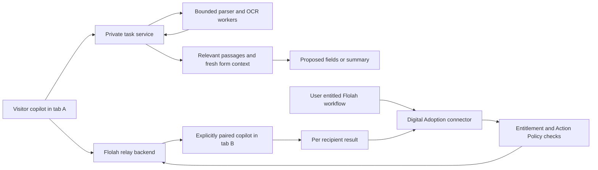

# Digital Adoption Copilot end to end design

Design baseline agreed through the requirements discussion on 18 October 2026,
Asia/Singapore. This document consolidates the decisions for implementation.
The private attachments, pairing and workflow connector implementation now has
its own tests and deployment candidates. The earlier release's tests do not
certify these additions; the separate results report records actual coverage.

The product remains website independent. A visitor can attach transaction files,
extract information relevant to a current or requested form, summarize that
information, and continue an explicitly linked task across website copilots.
A signed-in Flolah user can run their entitled workflows against those same
paired sessions through a Digital Adoption connector. Flolah Action Policies
determine execution authority.

## 1. Agreed requirements

- Transaction attachments belong to a private task. Delete files, extracted
  content, values and private task context when that task ends. They never
  become shared website help documents, source maps or published lessons.
- Visitors may upload and explicitly pair copilots without Flolah login.
- Pairing is initiated and confirmed inside the copilot panels. No persistent
  coordination tab or browser extension is required.
- User-confirmed pairing is sufficient. The paired group represents chosen
  connections; it is not a physical browser or device fingerprint. A user who
  deliberately transfers a pairing code to another device can pair that device.
- Cross-website members must belong to registrations with the same website
  owner. Registration and environment identity remain distinct even where two
  registrations share an origin.
- Handoffs can carry relevant extracted passages, field values and task results.
  Shared knowledge indexes, unrelated chats and full attachments remain separate.
- Workflow execution requires the end user's verified Flolah sign-in and their
  own workflow entitlement. Website ownership does not grant that user's workflow
  access, and Flolah sign-in alone does not pair their tabs.
- Workflow editor integration is a connector node, not a new autonomous agent
  type or an OpenClaw agent provisioned for every visitor.
- A node can select websites and relay to one paired instance or all active
  paired instances on those websites within one selected group.
- Delivery is immediate to the captured recipient set. No delivery queue targets
  future visitors, and a new visitor never replaces a failed recipient.
- A closed, disconnected, expired or login-blocked target fails its affected
  workflow step as soon as the condition is detected. No automatic resumption
  or replay of a possibly executed host action.
- Existing Flolah Action Policies govern autonomous, approval-required and
  prohibited actions. A relay prompt does not itself authorize browser writes.

## 2. Product surfaces and end to end flow

The visitor Guide composer gains Attach transaction file, Task files,
Summarize, Pair another copilot, Paired sessions and End task controls. These are
visitor task features; the existing owner-only Actions menu remains owner-only.
Extraction status, source references, reviews and errors appear near the bottom
of the current conversation. The user can remove an attachment or revoke a
paired connection without entering the owner console.

The website management console separately configures transaction attachments,
pairing, workflow relay, action bindings and resource limits for each
registration. Enabling a visitor capability never grants owner coaching access;
the backend enforces those registration policies for every request and delivery.

Form filling, navigation and Save remain separate effects. User-driven tasks
retain the current review UX. Workflow-driven execution uses the existing policy
decision: autonomous actions can proceed within their exact authorized bounds;
approval-required actions use Flolah's approval mechanism; prohibited actions
do not execute. Do not add an unconditional extra approval for every autonomous
workflow action, or remove the existing review from ordinary visitor chat.

## 3. Identity and authorization

The server owns these identifiers and their bindings:

- `websiteId`: immutable registration/embedding ID, with origin, environment,
  current organization/owner and approved installation policy.
- `sessionId`: the existing authenticated runtime conversation scope.
- `instanceId`: a fresh SDK instance in a particular tab. Reloading creates a
  new instance; an old instance never inherits new approvals.
- `connectionId`: one authenticated live transport connection to that instance.
- `pairedGroupId`: the exact connections the visitor explicitly paired.
- `workflowUserId`: the verified Flolah end user, when a group is linked for
  workflows. It is derived from trusted login, never a request-body user ID.
- `taskId`: private data, participants, expiry and task lifecycle.
- `workflowRunId`, `nodeExecutionId`, `commandId` and `recipientId`: execution,
  correlation and duplicate-delivery boundaries.

Website owner and workflow user are separate principals. The owner may operate
the websites while an entitled visitor runs their own workflow. The workflow
user does not receive website management access. Registration transfer,
revocation and host sign-out invalidate affected permissions and pending work.

Anonymous pairing does not grant workflow access. To enable workflows, the user
signs in through a Flolah-controlled surface and explicitly links their group.
The backend issues a short-lived, single-use, audience-bound linking grant.
Embedded host pages never receive Flolah login cookies, passwords or broad
platform access tokens. Reusing the owner-management role gate is insufficient:
visitor workflow identity must use normal authentication and actual entitlement.

Discovery requires the authenticated workflow user, their linked group, selected
authorized registrations and active connection state. Another group owned by the
same Flolah user is excluded unless that run explicitly selects it. A group
already linked to one user cannot silently change to another signed-in user.

## 4. Pairing in the client panels

1. Tab A requests Pair another copilot using its current runtime credential.
2. The server creates a high-entropy, short-lived, single-use invitation and
   stores only its hash and initiating session binding.
3. The visitor enters or pastes that code in Tab B's copilot.
4. The backend checks both live installations, exact origins, current website
   ownership, group restrictions and rate/attempt limits.
5. Both panels show the counterpart website, environment and instance label.
   The visitor confirms the intended connection. No data is shared while the
   invitation is merely pending.
6. The backend consumes the invitation and records the exact members. Additional
   members require another invitation. Either side can disconnect.

Pairing does not use shared email, IP address, third-party cookies or a publishable
installation token as proof of user continuity. A code is never a substitute for
the target's own live runtime authentication. Codes are excluded from URLs,
analytics and logs. Pairing alone does not broadcast existing attachments or
unrelated conversation history to every member.

## 5. Private transaction files and form context

The initial supported transaction types are PDF, DOCX, UTF-8 text/Markdown,
PNG and JPEG, using the existing parser/OCR foundations. English extraction is
the first acceptance corpus. Spreadsheet formats, handwriting and additional
OCR languages require explicit parser support and their own acceptance evidence;
they must not be advertised as supported merely because the picker accepts files.

An attachment starts or joins a private task. The upload path validates extension,
MIME/signature, size, decompression limits and supported content. Private uploads
use a separate capability and storage path from the current shared-help upload
policy; visitors do not need permission to publish shared website knowledge.
The registration's transaction-upload setting remains an owner-controlled
capability, separate from the user's task and workflow permissions.

The parse result retains source locator/page and exact supporting text. The
planner combines the user's current request, a fresh live DOM snapshot, relevant
authorized website maps/lessons, and selected private task passages. Shared maps
can identify a requested form or destination; they do not supply executable refs.
If the requested form is elsewhere, guide the user or propose observed safe
navigation, then inspect again before preparing its fields.

The extraction result includes candidate value, intended field, source reference
and supporting passage. Missing, conflicting or uncertain consequential values
require clarification. Do not invent missing values, silently repair uncertain
OCR text or treat instructions inside a document as authority. Map only to fresh
supported controls; unsupported frames/custom controls remain explicit boundaries.
A summary uses source references and does not claim a form was filled or saved.

## 6. Task privacy and deletion

One task may span several chat requests, tabs and workflow nodes. A workflow that
creates a task closes it at its terminal outcome. A workflow that explicitly joins
an existing visitor task ends its own execution without silently ending or
retaining that parent task: the chat clearly shows its remaining private files
and End task control. Losing one recipient fails its step; the task may remain
active in another authorized participating tab. Losing all participating
connections ends the task. Reconnection never resumes a failed workflow step.

Private task history, extracted text, derived values and private reviews reside
in a bounded ephemeral store. Original upload objects are encrypted with a
task-specific key held outside durable SQLite/config checkpoints. Parser scratch
files use the isolated workers' temporary memory filesystem. Avoid creating an
OpenSearch source/index for a transaction attachment.

Terminal task completion, cancellation, unrecoverable task failure, expiry or
identity termination immediately revokes access and destroys the task key and
private context. Cleanup removes raw ciphertext and scratch objects; failed
physical cleanup is tracked with content-free metadata and retried. A user may
also remove one attachment earlier. New tasks cannot revive an ended task or
recover its files through an idempotent retry.
All participating panels clear private task messages, file previews and pending
reviews at termination. Values the user already applied to the host form or
saved in a business record remain host data; ending the task does not undo them.

Coordinator restart ends ephemeral tasks and fails their unfinished workflow
deliveries. It does not resurrect old private data from application checkpoints.
The implementation must verify deletion and ciphertext-only checkpoint behavior;
ordinary live-row deletion alone cannot establish this privacy property.

Application deletion covers Flolah-controlled task stores. It does not undo
authorized business records already saved in a host website or claim to erase
an upstream model provider's independent retention. Provider processing must be
documented consistently with the deployment's actual retention controls.

## 7. Private data through workflows

The existing runner normally persists step input/output and context. Therefore,
adding an attachment vault alone is insufficient. Digital Adoption connector
inputs/outputs need privacy-aware handling across the workflow execution path.

Pass task-bound handles for private fields, passages and results. Resolve them
only for the entitled run and authorized recipient while the task is active.
Inject their values into execution memory without copying them into durable
workflow variables/context, step audit records, Kanban descriptions, tool logs,
model telemetry or error messages. Apply the same rule at downstream node and
template resolution, not just when rendering the connector's own output.

Durable audit keeps opaque correlation IDs, policy/effect classification, counts,
timestamps, terminal result codes and redacted summaries. Private handles expire
at task end. A workflow requiring later durable business data must use an
explicit authorized host persistence operation; task attachment upload does not
silently authorize long-term storage.

## 8. Cross website handoff

Tab A submits the target and task instruction to the Flolah relay backend. The
backend verifies active task membership, common website owner, linked-group
scope, recipient permission and the data-sharing grant. It sends only the
relevant selected passages, fields and results to Tab B over its authenticated
connection. Tab B inspects its actual current page before planning or acting.

The handoff can request a proposal, a summary, or a policy-authorized action.
It does not clone Tab A's chat, approvals, runtime credentials or shared index.
The target's existing host login and entitlements still apply. Results return
through the backend to the originating task and, where applicable, the workflow.

An attachment remains task-owned. A recipient receives the minimum permitted
context for its step; pairing does not grant blanket raw-file access. Every
attachment reference and result handle is checked against task and recipient,
even if an attacker knows another task ID.

## 9. Workflow connector and node attributes

Add a first-class Digital Adoption provider to the existing connector catalog.
Reuse the workflow `connector` node and attributes panel, with a recognizable
Copilot connector label. No per-visitor agent provisioning or separate autonomy
policy engine is introduced.

The node exposes:

- Connection: the current user's explicitly linked paired group.
- Websites: one or more authorized registration IDs, displayed with origin and
  environment. A domain string alone cannot select a different registration.
- Recipients: a selected instance, selected instances, or all active paired
  instances for the chosen websites. No all-visitors or all-user-devices option.
- Action: inspect, summarize, prepare fields, navigate, fill, explicitly
  classified native submission, get result/status, or cancel.
- Instruction and inputs: prompt, workflow bindings and authorized task handles.
- Context sharing: relevant passages, field values and task results within the
  active task grant. Full attachment/chat transfer is not the default.
- Delivery expiry, acknowledgement timeout and execution timeout.
- Fan-out limit and completion rule. Initial completion requires every captured
  recipient to succeed; failure retains per-recipient results.

Static website selection and runtime discovery are separate. The editor can
retain approved website choices when tabs are offline, but execution does not
wait for future visitors. Each selected website must have an eligible recipient
at dispatch; an explicitly selected offline instance fails preflight.

Save stable website choices and a runtime group binding/connection alias in the
workflow definition, not bearer credentials or a permanently hardcoded tab ID.
A run launched from a copilot carries its server-validated group reference; a
run launched from Flolah selects an eligible linked group. Scheduled runs must
have an explicit still-valid binding and fail when it has no eligible sessions.
Never guess the current browser from the account's most recently active device.

Connector discovery, editor execution, direct connector API and workflow runner
execution must call the same authorization service. The current runner invokes
connector execution directly, so tool-route middleware alone cannot enforce the
new policy boundary. Register explicit action metadata and grant checks for the
provider; do not rely on keyword classification of a free-text prompt.

Transport acceptance is not workflow success. HTTP 200, a WebSocket send or an
acknowledgement cannot complete the node. Aggregate the required recipient
outcomes and map policy/approval, execution failure, expiry and unknown outcome
into the existing runner's appropriate terminal or approval state.

## 10. Recipient snapshot and delivery

At dispatch, capture the exact eligible active recipient set for the authenticated
user, chosen group, website registrations and task. Preflight all required
recipients and permissions before dispatching a mutating fan-out. Zero eligible
recipients for a selected website fails the node.

New instances joining later do not receive the command. An offline instance is
not replaced by another visitor. If a captured recipient disconnects, fail that
delivery and the required-all workflow node, preserving completed results from
other recipients. Fan-out is not a distributed rollback transaction: completed
host changes remain and must be reported accurately.

Delivery expiry prevents late execution of this captured command. It is not a
subscription that keeps delivering to future visitors. A future owner-managed
visitor campaign would need a separate public-message data model, visitor opt-in,
recipient limits and per-visitor deduplication. It is outside this implementation
and cannot contain another user's private transaction context.

## 11. Action policy and host execution

Use the existing Flolah Action Policy modes and company/workflow/agent/tool or
connector-action scope rules where applicable. Canonical server context binds
the actual user, run, node, connector action, target registrations, recipient
snapshot and proposed effect. Neither a client flag nor LLM text can select its
own approval level, user identity or risk tier.

Inspect/summarize/prepare perform no host mutation. Filling can trigger host
autosave and retains the browser inspector's existing checks. Submission is a
separate effect; classify from a trusted explicit action contract or validated
host/owner binding. Missing effect classification blocks autonomous submission;
never infer that a Save is harmless from its label or website name. Financial,
destructive and external effects retain their corresponding policy classification.

Apply policy at the shared execution service used by every entry point. Recheck
current authorization before dispatch and before each consequential effect.
Approval grants are exact, bounded and single-use; their constraints cover the
actual payload and recipient set. Retry/forwarding must not consume a grant twice
or turn one approval into unrestricted fan-out. Policy change, revocation or
host sign-out invalidates remaining authority.

Autonomous mode permits only supported effects within that decision. A fresh
DOM snapshot and revision check still precede filling, navigation and submission.
No arbitrary JavaScript, unreviewed code or invented selectors may arrive over
the connector transport. Existing owner-only Actions stay owner-only.

## 12. WebSocket and command protocol

The SDK authenticates its runtime session over HTTPS and obtains a short-lived,
single-use connection ticket bound to instance, registration and origin. The
WebSocket authenticates in an initial frame with a strict timeout and Origin
check; credentials and private prompts are excluded from URL query strings.
Use WSS for deployed browser transport, bounded frames, backpressure and
heartbeats. Revalidate session/installation/identity policy while connected.

Command metadata includes command and task IDs, group, recipient instance,
workflow run/node execution IDs when present, instruction, task-handle inputs,
exact permitted effect, policy reference, expiry and correlation ID. Server
signatures or opaque capabilities are scoped to that exact execution. The
browser cannot broaden a command by editing its metadata.

Lifecycle: preflight, policy blocked/awaiting approval, dispatched, acknowledged,
executing, succeeded, failed, expired or cancelled. Results distinguish prepared
proposal, observed field values, navigation verification, submission dispatched,
host-reported result and independently verified saved-record readback. Only the
last applicable evidence can establish a verified business save.

Use per-recipient idempotency keys bound to run/node execution and command.
Duplicate delivery joins the same operation or returns its known terminal status.
Never repeat a host action because an acknowledgement was lost. After possible
dispatch without outcome proof, return `OUTCOME_UNKNOWN` and fail the step;
request inspection instead of claiming failure of the host write or retrying it.

Pairing revocation, task termination, host sign-out and connection closure fail
affected unfinished work immediately when observed. A silent network loss is
detected by a bounded heartbeat/acknowledgement timeout; immediate failure does
not imply physically instantaneous network-loss detection. No offline action
queue or automatic step resumption follows reconnection.

## 13. Operational defaults and scaling

The initial application target remains 25 website registrations and 25 concurrent
users. The existing short pilot exercised 25 concurrent sessions, not the new
multi-tab/private-file workload. New capacity acceptance must include at least
two connected instances per user, private uploads, fan-out and disconnects.

Initial engineering defaults, configurable and subject to implementation tests:

- Pair invitation: two-minute expiry, one use and bounded failed attempts.
- Task: 15-minute idle timeout and 60-minute absolute lifetime, with explicit end.
- Attachments: 16 MiB each, four per task, 64 MiB total; reject unsupported files.
- Group/fan-out: up to 25 instances, also bounded by global/user limits.
- Command: 60-second dispatch validity, five-second acknowledgement timeout,
  and an action-specific execution timeout. Human approval never extends a stale
  target or reuses an expired DOM proposal.
- Heartbeat: five-second cadence and at most 15 seconds to declare silent stale
  presence. Known close/login-required conditions fail without this wait.
- Parser pool: two workers at the currently tested VPS allocation, with a combined
  global ceiling across shared-help and private-task jobs, per-website fairness
  and bounded retries only for non-effectful extraction.

Bound active users/groups/connections, buffered bytes, task context and per-user
uploads. Shared help ingestion must not monopolize transaction extraction, and
private jobs must not starve shared work. Report active connections, oldest
eligible job age, fan-out failures, private cleanup backlog, policy denials,
429/5xx rate and resource pressure without recording source values.

Keep the current single stateful coordinator/local SQLite boundary. Stateless
parser workers can scale to configured limits. A future multi-replica coordinator
needs shared ownership, presence/routing, transactional idempotency and a
privacy-compatible ephemeral key/data strategy; do not share SQLite WAL over
network storage or claim Kubernetes HA from the current pilot.

## 14. Integration and implementation sequence

1. Private task lifecycle, ephemeral context and encrypted file objects; separate
   visitor capability, parser scheduling and deletion tests.
2. Composer attachments, extraction summaries and evidence-backed current-form
   proposals using fresh controls and the existing review UX.
3. Pair invitations, bilateral confirmation, scoped instance registry and WSS
   transport; anonymous pairing and authenticated workflow linking.
4. Cross-website relay, recipient grants, result return and duplicate/disconnect
   behavior.
5. Digital Adoption connector catalog/actions, website/recipient selectors,
   workflow identity/entitlement, existing policy integration and privacy-aware
   workflow input/output resolution.
6. End-to-end local/public browser acceptance, policy/failure tests, capacity
   measurements and the updated pass/partial/fail report.

Primary integration areas are the independent SDK/widget/server and parser pool;
Flolah's connector registry/execution service; the workflow editor and runner;
and the existing policy/authentication services. Changes must be additive and
preserve Platform Help Copilot and unrelated workflows. Keep source, packaging,
Docker, proxy/WSS setup and operator documentation aligned with each release.

## 15. Acceptance journeys

The cases below define acceptance; they are not an automatic pass list. Browser acceptance uses only the
loopback website `http://127.0.0.1:4194` and public `https://flolah.cloud` pages.
Flolah account authentication for workflows is a separate control-plane flow;
it does not authorize logging into or submitting public staging website forms.
Keep the laptop loopback-only. A live public preview requires a valid scoped
authorization; an old six-hour preview approval is not perpetual permission.

- **TX01:** Upload a synthetic onboarding PDF and PNG scan containing company,
  contact email, region, requested integration and transport. Parse/OCR, summarize
  with source locators, and extract values for the local Customer form.
- **TX02:** Prepare only supported current fields, show provenance, approve values
  and verify the local form. Independently verify the separately authorized
  synthetic saved record; do not equate observed values with a saved record.
- **TX03:** Request a different form, use authorized map/navigation guidance and
  fresh inspection, and reject nonexistent fields or conflicting/missing values.
- **TX04:** Reject unsupported/spoofed/oversized files and malicious document
  instructions without exposing private content or publishing shared sources.
- **PAIR01:** Pair local and public website instances under the same registration
  owner; confirm in the panels. Anonymous visitors can pair without Flolah login.
- **PAIR02:** Reject wrong-owner registrations, expired/reused codes, unauthorized
  session/instance IDs, conflicting user linkage and unrelated group access.
- **RELAY01:** Pass relevant integration passages/values to the paired public
  MCP search page; propose/fill its search and transport controls and return the
  observed result. Block all public host POSTs and perform no public Save/search
  submission. Field names and routes are test fixtures, never bundled catalogs.
- **WF01:** A signed-in test user discovers only their linked eligible instances
  and invokes their own entitled workflow through the connector node.
- **WF02:** Website multi-selection and all-active fan-out capture only that
  group's current eligible recipients. Other visitors/groups and new arrivals
  receive nothing. Missing selected-website recipients fail preflight.
- **WF03:** Exercise autonomous, approval-required and prohibited policies via
  direct connector and actual workflow-runner paths. Validate per-recipient
  effects, exact fan-out approval constraints and mid-run revocation.
- **WF04:** Close/sign out/disconnect a target; fail and report the affected step.
  Simulate lost acknowledgements and duplicate commands; no repeated Save, new
  recipient replacement, offline delivery or false business-success claim.
- **PRIV01:** End/cancel/expire/fail a task and restart the coordinator. Verify
  inaccessible/deleted raw objects, parsed text, private reviews and handles;
  checkpoints contain no usable task plaintext or recoverable task key.
- **PRIV02:** Verify privacy-aware downstream workflow input/output resolution,
  step audit, run context, tool logs, Kanban and model telemetry. Website owner,
  another visitor and another task cannot retrieve transaction content.
- **CAP01:** Measure 25-user/25-registration workload with at least 50 connected
  instances, private extraction, policy checks and fan-out. Publish declared
  corpus, concurrency, p95 latency, throughput, cleanup and resource results.
- **HOST01:** Confirm that public staging remains no-login/no-submit and that
  the laptop fixture remains loopback-only throughout every browser journey.

The final testcase report records actual passed, partial, failed and not-run
cases with evidence and recommendations. No new feature is certified by the
prior 174-test suite or the earlier shared-knowledge capacity pilot. Existing
real Safari/macOS/iOS, Android Chrome and screen-reader deferrals remain explicit.

## 16. Existing baseline and design references

The last verified application baseline is release `20261017bk`; source integration
and setup were pushed to main at `1de1054f`. Its existing tests and measurements
are documented in [build and setup](deploy/README.md) and
[scaling and recovery](deploy/scaling.md). This design adds capabilities to that
baseline and does not change its certification status by itself.

Implementation anchors: `src/server.mjs`, `src/session-authority.mjs`,
`src/source-ingestion.mjs`, `src/worker-server.mjs`, `src/platform-model.mjs`,
`web/sdk.mjs`, `web/widget.mjs`, `backend/src/services/action-policy.js`,
`backend/src/services/connector-action-grants.js`,
`backend/src/services/agent-workflow-runner.js`, and
`frontend/src/pages/AgentWorkflowEditor.jsx` (backend/frontend paths are relative
to the repository root).

Browser pairing uses explicit user consent and server scope checks rather than
assuming cross-domain browser storage is shared. Relevant browser behavior:
[same-origin policy](https://developer.mozilla.org/en-US/docs/Web/Security/Defenses/Same-origin_policy),
[WebSocket interface](https://developer.mozilla.org/en-US/docs/Web/API/WebSocket),
and [COOP window references](https://developer.mozilla.org/en-US/docs/Web/HTTP/Reference/Headers/Cross-Origin-Opener-Policy).

## 17. Guided-session feedback implementation

Server workflow access does not depend on peer pairing. A visitor can issue a
workflow link for this copilot alone, even when the owner's pairing capability
is disabled. In the signed-in workflow editor the user links it as a new saved
target group or adds an independently authorized copilot to their selected
same-owner group. The workflow stores that stable target group and websites.
Peer handoff is a separate persisted bilateral grant between participants;
merging workflow targets never grants document relay. Both workflow capability
and current Action Policies are checked without requiring pairing capability.
Revoking a membership removes its server target authorization and peer grants.

Pairing consent and live execution authority have separate lifecycles. A named
group persists its owner, linked workflow user, website/origin membership,
consent expiry/inactivity settings and hashed browser reconnect proofs in
`paired_groups`. The confirmer chooses 1/4/8/24 hours or until revoked and an
optional inactivity expiry. A recognized browser may reconnect to the same
group with a fresh endpoint after reload or coordinator restart. Revocation,
expiry, owner/policy changes and host-identity changes are rechecked. Raw
reconnect proofs stay in browser storage, not SQLite. Pairing is explicit user
consent; it is not inferred from website ownership or email.

Offline endpoints receive nothing. Reconnection restores neither task data nor
effect approvals, and never retries a failed workflow action. Saved groups remain
discoverable for their linked user while endpoints are offline. Workflow nodes
save the stable group and selected websites once; every run checks current
eligible recipients. Pair presence refreshes separately from user activity.

The bottom chat composer handles both ordinary prompts and `@` paired-recipient
handoffs through Send. Task files & paired copilots is for upload, pairing and
sharing consent. Sender chat records the instruction, selected context,
recipient and delivery time while the private task exists. Workflow messages
show incoming instruction, workflow/run/step correlation, progress and readable
results. Ending the task clears private instructions, files and extracted data;
only structural inspection/completion traces remain. Workflow audit outputs
retain structural fields/forms/navigation counts and labels, excluding entered
values and document text. Downstream private results use task-bound handles.

Every reviewed field/save/recorded step supports rejection or cancellation.
Generic action feedback disables pending controls and reports completion/error
at the bottom for three seconds; persistent errors retain their detailed banner.
Bootstrap renders a visible connecting/retry control before downloading the SDK
and bounds each bootstrap/import attempt to eight seconds. Host forms do not
wait for copilot startup. Only idempotent bootstrap may retry automatically.

Mixed natural-language requests use semantic planning against fresh controls;
checkbox selection language is interpreted using observed labels/types. A
summary-only/no-fill request cannot produce write proposals. Native radio
groups, multiple selects, datalist inputs and input-based ARIA comboboxes are
supported. Async picklists require a unique visible exact option in the
associated listbox, reject intervening edits and time out without clicking.
Unsupported components remain manual. Actual React controlled state and Angular
ngModel state, followed by independent synthetic record readback, are exercised
by the test-only framework fixtures; this does not claim every framework widget.

New runtime installations have no automatically seeded handbook, map or recipe.
Development-only seeding requires `demoSeedEnabled: true`. Existing UAT
registrations retain their historical sources and cannot prove empty onboarding.
The empty self-service integration test exercises owner registration, ownership
verification, approval and observation using synthetic DNS/email transports.
See the feedback acceptance ledger for the distinction from live DNS UAT.

### Verified guided-feedback results

See [the screenshot-linked testcase table](test/evidence/feedback-20261018/index.html)
for the final 30 passed, four partial and three deferred composite cases.
Guided feedback is 18 passed / one partial; the latter is real fresh DNS/email
onboarding, which the historically provisioned fixture cannot establish.
Full-phase certification remains partial. Current runtime I / platform F pass
208 application tests locally and in the deployed image. Ten adapter/framework
checks are distinct from nine real LLM/visitor journeys.

Run 4063 proves prior task-result grounding with no visible current fields:
`inspect-prior.result.taskId` and
`inspect-prior.result.recipients.0.resultHandle` feed the following Copilot
summarize operation. The task-bound planner resolves the authorized handle
before model invocation. It reports three earlier required fields after the
synthetic current form is hidden. Task cleanup invalidates that handle.

Native field constraints are checked on a detached probe before host mutation;
constraint changes after inspection require a fresh review. Async picklists
refuse empty/error/ambiguous results and keep dependent controls unavailable
until a unique real option is selected. These tested HTML/ARIA contracts do not
claim support for every vendor grid, shadow component or browser/device.

## 18. Owner pairing administration and visitor analytics

The existing visitor-selected expiry remains: 1/4/8/24 hours or until revoked,
with optional inactivity expiry. Authenticated website owners and validated
platform administrators can list groups for an authorized registration, see
online/offline participant aliases, revoke a whole group and shorten or extend
expiry directly. This administrative authority follows the user's explicit
18 October policy decision. Connected panels receive the changed expiry and
can disconnect at any time. Expiry updates do not revive ended tasks or replay
commands. Adding a workflow target cannot widen expiry as a side effect.

Management uses the existing owner/administrator authentication and ownership
checks. Request JSON cannot supply roles. Lists are paginated (25 by default,
100 maximum), omit host identity, reconnect proofs, private files and chat, and
are scoped to a selected website under the same owner. Audits record the actor,
registration, group, reason and requested/completed outcome. Related controls
are disabled together during asynchronous changes to prevent refresh/mutation
races. Revocation persists removal before ending live authority, cancels
remaining commands, destroys related private-task access and rotates endpoint
reconnect proofs. It never undoes a completed host action. Failed persistence
restores the old expiry and cannot acknowledge a revoked group as saved.

Analytics is a separate optional subsystem, Off by default on every registration.
The user approved 30-day opt-in collection on 18 October 2026. Owner enablement
and visitor acceptance remain required; deployment alone enables neither.
Owners can configure live-event retention
(7/30/90 days), the enable switch and optional network hints. A policy revision
requires fresh visitor consent. Ownership transfer disables analytics and bumps
its revision. Operational checkpoints follow their own existing expiry policy;
live-event deletion is not a promise to erase those checkpoints immediately.

The client collects only after acceptance: hashed page views, navigation/button
clicks, form starts, field-interaction counters, native validation events,
submit attempts, approximate active time and copilot exposure/open/close. It
never reads entered values for analytics. URLs, query strings, labels, field
values, prompts, filenames, document text, host identities, private task/result
IDs and raw IPs are excluded from the event schema. Known structural page/form
labels are resolved for the owner from authorized discovery maps. Unknown
routes remain hashed/unmapped until discovered; analytics does not publish new
knowledge into the website's shared help index or task context.

The service adds authenticated request/outcome counters for answers/plans,
reviews/approvals, private uploads/summaries, handoffs, pairing confirmations,
workflow planning/effect authorization, per-recipient workflow completion/failure
and verified-save learning. Request success, fill dispatch, submit attempt,
receipt check and verified-save learning are distinct events; none is silently
promoted to a verified business outcome. Reports include consenting browser IDs,
sessions, daily activity, heavily used forms/pages, validation friction, page
transitions, form-heavy/copilot-assisted/friction cohorts and bounded request
p95. Form starts without observed submits are a friction indicator, not proof
of abandonment. Session/browser IDs do not count identified human beings.

First-party visitor IDs stay website-scoped and are HMAC-pseudonymized server
side. Optional network hints use a daily rotating HMAC over a coarse IPv4 /24
or IPv6 /48 prefix, scoped to both website and current owner. Only explicitly
configured trusted proxy peer addresses may supply a forwarded client address;
otherwise no network hint is recorded. No canvas/fonts/device fingerprinting is
used. A possible-match edge additionally requires the same browser family and
at least two substantially overlapping pages. Shared NAT/VPN and shared-device
cases remain ambiguous. Suggestions never merge profiles, enroll a visitor,
pair tabs, alter a group or authorize workflows. They are evidence-labelled
hypotheses, not calibrated identity probabilities or a cross-domain index.

Events use a dedicated indexed SQLite table, strict schemas, 20-event batches,
per-session admission and configurable site/global/report bounds. The default
limits are 50,000 events/site, 500,000 total and 20,000 rows per report. Reaching
a quota refuses new analytics without affecting host/copilot actions. The UI
shows row/storage limits. Analytics requests run outside the effect queue with
a two-second bound and cannot invoke effectful endpoints. Opt-out stops local
listeners/queues immediately; subsequent SDK requests also revoke the server
analytics binding if a separate opt-out notification was lost. Analytics traffic
does not touch pairing/private-task inactivity. Eligible actual host activity
can keep its runtime session active; collection ends with runtime authority.

Reference metric families, reviewed 18 October 2026:
[WalkMe Insights](https://support.walkme.com/knowledge-base/about-walkme-insights/),
[WalkMe terminology](https://support.walkme.com/knowledge-base/insights-terminology/),
[Countly Basics](https://support.countly.com/hc/en-us/articles/900005345323-Countly-Basics),
[Countly cohorts](https://support.countly.com/hc/en-us/articles/25324248147740-Cohorts-Explained).
These informed the metric vocabulary; this release does not embed either vendor,
record session playback or claim full product parity.

### Task-grounded control choices (18 October 2026)
Automatic discovery still excludes option labels and current field values. For an explicit task mentioning a native choice control, the browser supplies at most 20 enabled labels per control and 60 overall. These task-scoped hints inform the model and review; they do not enter shared discovery or analytics. Exact labels, singular/plural wording and unambiguous small spelling errors resolve to observed choices. Unknown or ambiguous choices require clarification. Business names, email addresses and amounts remain literal. Recommendations alone do not authorize a fill. Execution rechecks current control state and existing Action Policies.

Descriptive preferences and comparisons use the observed choices as evidence for semantic planning, rather than treating the whole phrase as a literal option. A uniquely supported interpretation produces an ordinary review proposal; unsupported named values produce a focused clarification. Concrete keep/reset requests still prepare review because current field values are not sent to the server. Navigation intent is resolved from the request prefix before a current field's data; mentioning another resource inside Note text does not navigate away. These rules are independent of website vocabulary.

### Visitor review and workflow authority

Visitor chat approves a validated proposal through its field-change review. Workflow commands use the same proposal/effect validation, but the server checks current workflow Action Policy authority before approving the matching proposal. Each effect is checked again against its command, recipient, connection, policy fingerprint and expiry. No visitor review-button click is required when the workflow has authorized autonomy. An owner-reviewed Save binding restricts the exact route, visible control and effect family; it does not itself grant general authority. Save is a separate command from filling. Run 4066 used a temporary three-use fill grant plus internal-write-authorized local Save bindings; that grant was removed afterward. Independent persisted record readback establishes the three test Saves, beyond mere command completion.

Workflow command status publishes an explicit recipient contract: instance/website/connection identifiers, status/code/start time, permitted inspection and opaque result handles. Internal proposal/effect bookkeeping and private effect values are excluded. Task data remains governed by task lifetime. Historical synthetic audit output is not rewritten by this serializer change.

Global maker/checker is implemented as an Admin-controlled setting, disabled by default. The independent gateway reads the current platform setting and active slot for each request. When enabled, model-generated plans and grounded knowledge/private-task answers require an independent checker; explicit local field/navigation shortcuts also consult the gateway and cannot bypass review. When disabled, the normal maker and bounded deterministic planning behavior is retained with no checker inference.

The active configured slot is the maker and the inactive slot is the checker. Admin may instead select the registered local Ollama reasoning deployment for the checker. That explicit global efficiency route does not inherit arbitrary visitor identities or unrelated company utility preferences. It uses native JSON/thinking output and excludes reasoning traces from responses/logs. It never falls back to a hosted checker. Provider/model credentials remain server-side and websites cannot select or disable review.

The checker returns a strict accept/revise/clarify/reject verdict. At most one maker revision is allowed, followed by another check; unresolved disagreement returns no actions. Deterministic response/control validation precedes acceptance and still applies in the browser. An unavailable or invalid checker fails closed. Existing Action Policies, visitor approvals, task grounding, expiry and exact owner Save bindings remain authoritative. Deterministic inspection, cancellation and owner-bound Save execution are control operations, not LLM content to be authorized by a judge. Model agreement is not business-success evidence; host readback is still required. Seven representative live intent cases do not establish arbitrary-website browser-agent parity.

### Platform-wide website administration

Admin navigation exposes `/admin/digital-adoption`. Its inventory uses the independent management service with the validated platform-admin principal, never an owner cookie or request-supplied role. A whitelisted metadata projection provides registration/owner IDs, domain, environment, verification/status, issued-installation count and enabled visitor capabilities. It omits credentials, DNS challenges, action bindings, transaction data and knowledge contents. Search/status filters and bounded pagination cover the full registration set beyond the legacy management list cap. Exact selected-registration management is independently authorized, including entries beyond that cap; owner principals still cannot select another owner's registration. No new registration is seeded for live UI validation.

The current global review setting remains disabled after UAT. Seven checked visitor cases pass through the inactive platform slot. The optional registered local reasoning model timed out at the bounded deadline in live testing and remains unaccepted for operational use on this deployment; deterministic failure handling kept the field unchanged. These results do not certify broad browser parity or concurrent model capacity.

## Website workspace usability and management capacity — 18 October 2026

The owner/account console has one persistent registration selector and seven accessible tabs: Installation, Knowledge, Website map, Teaching, Visitor groups, Analytics and Settings. Website search and paging expose registrations beyond legacy caps. URL context preserves selection and tab across refresh. Switching websites clears prior configuration, files, consent, knowledge and map views immediately; generation/context guards discard stale responses and refuse delayed actions for another selection. Approval and publication steps remain explicit. Learning preferences are loaded before edits can be saved.

The console uses authenticated, bounded management pages for website registrations, sources, current recipes, observed screens, reviewed source hints, versions, tokens and audit. SQL scope predicates precede LIMIT/OFFSET and content projection. Metadata lists exclude source text, sections and uploader session IDs. Recipe pages extract only the current version. Source revision metadata is bounded separately. Dynamic editors and map fields are created on expansion, with field/link and analytics-dataset paging. Analytics remains an aggregate view over its existing bounded retained-event query; it is not an unrestricted raw-event browser. Pairing governance keeps website-scoped existing pages and consent semantics.

Management protection separates a configurable shared-network ceiling from an authenticated per-actor budget. Login/code throttling has its own unchanged budget. A shared reverse proxy no longer compresses all legitimate owners into a single 60-request management allowance. This does not remove authentication or website entitlement checks, and does not make coordinator-local budgets distributed.

Runtime `20261018-owner-workspace-c` has 260 service passes, ten isolated UI passes, six analytics/governance UI passes and an isolated 25-client/25-website management benchmark. The signed-in administrator exercises the same deployed workspace against local and public Flolah registrations; fresh email-owner re-entry remains unobserved after its session expired. Review the separate workspace evidence for scope, screenshots and recommendations. Existing full Phase 1/2, device, local-checker and broad-agent gaps retain their earlier status.
