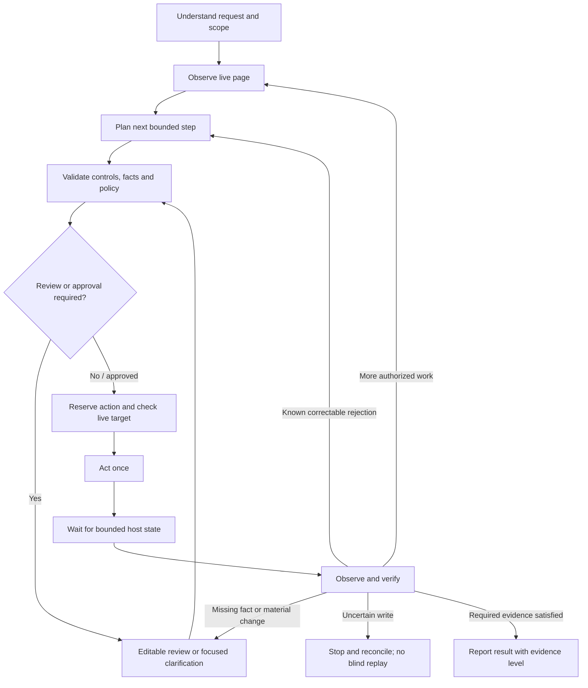

# Digital Adoption: immediate phase design

19 October 2026, Asia/Singapore. Source baseline: `b73b78b0`.

Status: implementation-ready proposal for the three requested priorities. This
document describes planned changes; it does not claim they are implemented or
certified. No runtime, website policy or model setting is changed by this design.
The existing [end-to-end design](DESIGN.md) supplies identity, privacy, pairing and
workflow constraints; the latest agreed decisions take precedence over its
historical implementation notes.

## 1. Outcome and scope

A fresh website owner can install the copilot, discover an approved set of
pages, teach and test a reusable task, and publish it without developer assistance
or direct backend data seeding. A visitor can request that task in ordinary
language, review/edit/reject proposed values, and understand what happened at
each step. Execution repeatedly observes, acts once, and checks the result.

Immediate scope is reliable supported controls, recoverable validation failures,
truthful progress/outcomes, and a complete owner setup journey. It preserves
existing Action Policies, separate Save authority, owner-only discovery Actions,
task privacy, explicit workflow linking and immediate failure of offline targets.
Public visitors do not become owners or gain workflow authority through a prompt.

The acceptance scope remains the loopback-only local website and public
`flolah.cloud` pages without login or public form submission. Signed-in Flolah
workflows and owner/admin consoles remain the control plane. No laptop exposure.
Real external DNS/email checks require an authorized domain owner and normal
product access; a mocked transport cannot satisfy that gate.

## 2. What exists and what needs improvement

These are source/evidence findings, not a fresh live recertification:

- [DOM adapter](web/dom.mjs): constrained native filling, exact choice matching,
  stale-control checks, local readback, bounded asynchronous accessible picklists
  and verified path navigation exist. A sequential action list is not a general
  dependency-aware observe/act/verify controller. React/Angular fixtures provide
  useful evidence, not universal framework or custom-component coverage.
- [Save controller](web/form-submit.mjs): checks native form validity and consumes
  a Save ref before one click. It distinguishes host success/failure messages and
  explicitly returns `businessVerified:false`. A success toast is not persisted
  record proof; its current text heuristics and observation window need a richer
  outcome contract.
- [Proposal store](src/proposals.mjs) and [SDK](web/sdk.mjs): session/version-bound,
  expiring, single-use approvals exist. The UI has Approve and Reject; editing a
  proposed value before application needs a supported revision flow.
- [Private task effects](src/private-tasks.mjs) and [task client](web/task-client.mjs):
  exact recipient/policy checks, ordered effect consumption, captured fan-out and
  no offline replay exist. Browser exceptions are often reduced to a broad
  unknown-outcome result. Recovery needs typed failures and persistent,
  content-free attempt fencing across coordinator restart.
- [Action feedback](web/action-feedback.mjs): busy buttons and three-second
  completion/error notices exist. A transport-level completed notice must not
  imply task success or erase a material unresolved error.
- [Owner workspace](web/manage-shell.mjs): persistent website selection, seven
  tabs and paged data exist. Setup is still distributed across registration,
  verification, installation, coaching, maps and teaching controls.
- [Recipe validation](src/learning-runtime.mjs): checks field-key compatibility
  against recent observed maps and gates publication by version/fingerprint.
  It does not run the task or prove a successful Save. The UI must name these
  different kinds of evidence accurately.
- [Registration](src/control-plane.mjs): domain DNS proof and separate platform
  admin approval are intentional gates. Self-service cannot bypass either.
- [Fresh-owner evidence](test/evidence/feedback-20261018/results.json): F01 remains
  partial. Isolated empty onboarding used synthetic DNS/email transports; the
  existing local registration has historical operator provisioning and seeds.
- [Latest retention evidence](test/evidence/private-retention-20261019/index.html):
  273 service tests pass; the 90-second browser summary with Ollama checking
  enabled failed, and elapsed 24-hour physical deletion is pending. These are
  explicit baseline gaps, not new passes from this design.

The implementation should extend these paths, rather than introduce a second
execution engine or duplicate owner-management application.

## 3. Shared execution contract

One task controller serves visitor chat, published recipes and workflow commands.
Their authorization differs; their observation and outcome semantics do not.

The maker reasons over the current instruction, permitted private passages,
current live control evidence, relevant maps and published lessons. When enabled,
the existing global checker reviews the proposal with its current one-revision
limit. Neither model grants permission or verifies its own effects. The browser
and host outcome integration provide those observations.

The model may resolve unique spelling/grammar variants and supported option
comparisons. It must preserve supplied business facts and clarify consequential
ambiguity. A note body mentioning another resource is data, not a navigation
instruction. Set, ensure and preserve-current intent are distinct: an already
satisfied value is a verified no-op, not a reason to fire another input event.
Current values remain local unless the user explicitly supplies/shares them.

### States and evidence

Internal states: `observing`, `planning`, `awaiting_input`, `awaiting_review`,
`authorizing`, `applying`, `waiting_host`, `verifying`, `completed`,
`completed_unverified`, `blocked`, `cancelled`, `outcome_unknown`.

Every result names an evidence level:

1. `prepared`: proposed changes only; nothing applied.
2. `local_state_verified`: requested field/selection or destination observed.
3. `host_reported_saved`: the host explicitly reports success, without independent
   business verification.
4. `business_verified`: approved host receipt/readback proves the requested
   persisted result with the correct task/action binding.
5. `rejected` or `unknown`: known rejection versus uncertain effect.

Transport acknowledgement, proposal approval, dispatched click and workflow
completion bookkeeping are separate events. A workflow reports success only
when the node's declared outcome requirement is met. Existing nodes remain
backward compatible with their documented effect contract, but must never be
relabeled business-verified. A new `requiredOutcome` setting makes stronger
verification explicit. Missing verification after a possible Save reports an
unverified/unknown write, not an assertion that nothing was saved.

## 4. Execution reliability

### Fresh controls and dependent fields

- Resolve only a unique current live control within the intended form, dialog,
  route and session generation. Saved semantic keys are hints, never executable
  refs. Ambiguous matching stops with one focused question or manual guidance.
- Execute one dependency stage at a time. Example: set Country, wait for Region
  to become enabled and its options to stabilize, inspect again, then prepare the
  Region choice. Never apply an old option/ref to a rerendered dependent control.
- Rebind after DOM replacement, modal changes, route changes, row sorting or
  dependent-option changes. A changed label/form meaning requires new review.
  Table actions require a unique observed row identity, not an old row position.
- A visitor's initial approval covers only its explicit reviewed changes.
  Newly discovered dependent choices receive a new inline review. Autonomous
  workflows can proceed only through fresh proposals and existing policy checks.
- Native fields retain constraints/type checks; accessible custom controls need
  explicit bounded adapters. Closed shadow roots, unsupported frames and trusted
  gesture controls retain a clear manual boundary. No claim of universal HTML
  or framework compatibility.
- Detect no-op assignments locally and avoid redundant change events. Websites
  can autosave on input/change: keep that warning and model potential side
  effects in the existing authorization policy. “Do not click Save” must not be
  advertised as a guarantee that an unknown host has no autosave behavior.

### Validation and repair

Collect structured, form-scoped native validity, `aria-invalid`, associated error
descriptions and newly appearing host status. Distinguish incomplete loading,
disabled dependency, field constraint, required missing value, business rejection,
ambiguous option, unavailable control, revoked permission and uncertain outcome.
Host text is untrusted evidence; redact unrelated values and secrets before any
model request. Do not transmit all page text or current form values for repair.

For a known rejection, explain the field and next useful action. A uniquely
supported formatting/option repair can be proposed within the original intent;
inventing an email, amount, customer identity or missing mandatory fact cannot.
Preserve successful earlier fields. Do not refill the whole form or retry Save
merely because one later step failed. Partial edits do not require filling every
unrelated mandatory field; full-form Save does require host validity.

Proposed configurable budgets: at most two repair proposals and three navigation
steps per task segment, one optional retry for a read-only transient failure,
and no automatic retry of an uncertain effect. Use bounded stage deadlines and
one overall segment deadline; nested retries cannot extend work indefinitely.
The checker keeps its existing independent one-revision cap. Surface model
capacity/deadline failure accurately, without a hosted fallback that the admin
has not authorized.

### Prevent repeated effects

Use an `actionId` bound to task/actor, registration, form/route, proposal version,
policy decision, recipient and connection generation. Before granting a write,
atomically reserve its attempt in a coordinator-owned, content-free ledger.
The browser also records an opaque local dispatch marker before activation.
Repeated click, duplicate command, lost grant response and reconnect cannot
silently create a second attempt for that same action.

Attempt states: `reserved`, `dispatch_started`, `observed_rejected`,
`effect_observed`, `verified`, `unknown`, `cancelled_before_dispatch`.
Advance with compare-and-set/fencing, never a caller-supplied success flag.
Retain bounded tombstones for the action replay window; proposed default is
24 hours, with action grants expiring much earlier. An expired action ID is
rejected, not interpreted as a fresh command. Existing workflow operation IDs
stay stable across retries. New actions require fresh authorization.

A browser click and remote business commit cannot be made into an exactly-once
transaction by this ledger. A crash around dispatch is conservatively unknown.
If the host supports idempotency, pass the same approved key through its optional
integration and reconcile before any new attempt. Otherwise stop and guide a
readback check. No automatic replay after process recovery, offline delivery or
unknown Save outcome. Stopping cannot undo an already committed host record.

### Save and host proof

Keep separate visitor Save review and exact owner-reviewed action bindings for
workflow submission. Recheck host validity and policy immediately before the
single dispatch. Observe the host within its bounded profile; no response or a
generic toast cannot prove persisted correctness.

Offer an optional owner-configured outcome profile: native host status, approved
record-readback flow, or host-signed receipt. Reuse existing identity/key
infrastructure with a distinct action-outcome purpose and action binding; do not
silently accept a learning-only receipt as a Save receipt. Signing keys and host
login credentials stay with the host. The service must not fetch arbitrary
private URLs supplied by a prompt. No JSON is required for the common owner UI;
advanced reviewed configuration remains available.

Hosts without a stronger integration still support reviewed filling and honest
host-reported Save status. They do not receive a business-verification badge.
For local Customer → Note → Opportunity acceptance, verify saved records and
their relationships independently from the copilot result. Public Flolah
acceptance remains read-only; never use its public forms to prove writes.

## 5. Task transparency and review UX

Use one conversation and its standard composer/Send. Pairing/files remain setup
controls; workflow and handoff instructions/results appear in the same history.
Do not add another permanent action toolbar beside the existing one.

During work show a concise current stage, elapsed time and the next expected
event: “Loading Region options”, “Waiting for checker”, or “Checking saved
record”. Do not invent percentages or an ETA. The initiating action is busy and
guarded against repeats; Stop remains usable. Distinct conflicting task actions
are blocked centrally, not only by disabling the last clicked button.

### Inline review

The review card has field labels, user-readable choices, proposed values and
relevant document references. Current values, when displayed, are read locally.
Controls are **Apply changes**, **Edit values**, and **Reject**. Use actual select,
radio, checkbox and multi-select editors where supported, not technical strings
such as `true`. Save remains a separately labeled consequential action.

Editing creates a new server-validated proposal revision bound to the fresh
snapshot and existing policies. It invalidates the old approval. Material
changes require fresh policy/HITL approval; editing is never a client-side bypass.
If the visitor changes the host during review, pause, show what changed and
prepare a fresh review. After a partial failure, list verified applied fields
and remaining fields; do not imply rollback. A user edit cannot be overwritten
by an old delayed model response.

### Errors and status

Keep the requested three-second action notice for brief feedback. Also preserve
material task errors in a bottom conversation status with a relevant next action
until resolved or dismissed. “Request refused” becomes a safe reason category
and a content-free support reference where available. Display “request completed”
only as transport status; business outcome text comes from the typed result.
Announce progress with accessible live regions, focus the field needing attention,
support keyboard review/rejection, and respect reduced motion. Do not rely on
color or a disappearing toast to explain failure.

Show connection dimensions separately:

- Current panel: connected / reconnecting / session expired / service unavailable.
- Workflow group: linked / expired / revoked; its saved lifetime is independent.
- Peer connections: online counterpart count, excluding this panel and identifying
  the exact registration/origin; workflow linking does not require a peer pair.
- Private task: active / ended, with files and access state separate from pairing.
- Installation: valid / expired / revoked when that is the blocking condition.

Reconnect can create a fresh session and restore a still-authorized saved group.
It does not extend consent, restore ended private files, reuse approvals or replay
failed workflow steps. Browser storage loss or invalid group authority leads to
explicit relinking. End task clears active context and access immediately;
temporary indexed passages follow the already agreed 24-hour ISM cleanup.

## 6. Owner onboarding

Keep the current website selector and seven tabs. Add a setup checklist inside
Installation, with deep links to Website map and Teaching, not a separate portal.
Its readiness is derived from server-authorized facts for the selected
registration/environment, not manually ticked client flags.

1. **Sign in and register.** Owner email or entitled Flolah login. Explain which
   identity is active. Register origin/environment with idempotent retries.
2. **Verify ownership.** Show exact DNS name/value, copy controls and last check.
   Distinguish absent record, mismatched value, expired challenge and resolver
   outage. Allow challenge renewal for a pending/unverified registration while
   retaining its ID; fence stale verification results against the new challenge.
3. **Receive platform approval.** Show “Ownership verified — awaiting platform
   approval” until the authorized admin acts through the normal UI. No developer
   database edit or trusted-fixture bypass. Fully automated platform approval is
   a separate policy decision and is not assumed by this phase.
4. **Install and check connection.** Copy the website-scoped snippet, open the
   actual host page, and show a recent successful initialization for that
   installation/origin. “Snippet issued” is not “Installed”. Provide actionable
   CSP, missing script, origin mismatch, expiry and blocked-frame diagnostics.
   A connection event is not proof of a human identity or physical device.
5. **Discover.** Issue owner coaching access through the UI. Choose an approved
   route list, inspect and discover within existing budgets. Show attempted,
   observed, blocked, unsupported and unvisited states. Required fields and
   navigation are structural coverage; “all website screens” is not inferred
   from a bounded crawl. Empty website help knowledge is allowed.
6. **Teach.** Record or author a parameterized task on observed controls. Present
   understandable parameter labels, dependencies and intended outcome. Use
   synthetic test values; private visitor passages must never become a lesson.
   Provide a simple native-action binding editor for optional workflow Save,
   preserving exact path/label/effect-family checks and advanced configuration.
7. **Check and test.** Show **Check compatibility** separately from **Test task**.
   First inspect structure/version compatibility. Then run in the authorized
   browser with fresh parameters, ordinary approvals/policies and visible results.
   Default test is read-only or reviewed filling; submission requires separate
   explicit authority on a safe test host. Capture evidence appropriate to the
   task's declared outcome. No silent Save during a “dry run”.
8. **Publish.** Owner reviews the current parameterized version and its evidence.
   Allow structural-only publication with a clear “not task-tested” label if the
   existing policy permits it; the immediate-phase **Ready for visitors** badge
   requires a successful current-version task test for the declared capability.
   Publication never grants autonomous execution or a stronger Save outcome.
9. **Verify as visitor.** Fresh browser session, no coaching grant, different
   parameters, no owner drafts or domain seeds. Show disable/unpublish and
   registration-scoped diagnostics if it fails.

Persist setup progress across owner sign-in expiry and website switching.
Version the evidence by website/audience, recipe version, map fingerprints,
permissions and declared outcome profile. Changed prerequisites invalidate
readiness. Do not force a second installation-recipient email flow unless its
existing delivery policy requires it; prefill verified identity only from a
trusted server assertion, not a browser-supplied email.

Self-service means no engineer provisioning/maps/recipes, not removal of the
platform's deliberate approval gate. Acceptance requires the owner and normal
policy approver to complete their product steps; a pending approval is an honest
blocked setup state, not a completed installation or an invitation to bypass it.

## 7. Components and data contracts

Planned extensions, not new deployed endpoints:

- `web/task-controller.mjs`: stage lifecycle, generation checks, cancellation,
  dependency sequencing and bounded recovery, shared by SDK/task-client paths.
- `web/host-observation.mjs`: scoped validation/settling/outcome observations;
  existing `dom.mjs` and `form-submit.mjs` remain the effect adapters.
- `src/action-attempts.mjs`: transactional attempt reservation and replay fencing
  backed by the existing coordinator repository. No claim of multi-coordinator HA.
- Existing proposals: revision/replacement operation for edited reviews;
  old proposal consumption remains invalid. Native types/choices revalidate.
- Existing command/result contract: typed stage, reason and evidence level,
  declared `requiredOutcome`, progress correlation and per-recipient results.
- Existing management: onboarding status, pending ownership-challenge renewal,
  approved action/outcome profile editors, task-test evidence and publication
  readiness. Every operation derives registration/owner/audience server-side.

Additive APIs should use existing visitor or owner/account prefixes and auth,
with idempotent operation IDs and expected revisions. Preserve current clients'
response fields during migration; only new capability-negotiated clients consume
new action semantics. No raw CSS selectors, executable code or arbitrary URLs
are accepted from the model as verification authority.

Database records hold configuration, non-sensitive readiness/test facts and
content-free attempt state. Do not persist private values, provider prompts,
document passages, field-value hashes vulnerable to guessing, or raw validation
messages in that ledger. Private reviews and results remain task-bound; private
document passages stay only in the separate temporary search store. Website
maps/lessons remain registration/audience scoped. Successful handoff does not
merge website indexes or authorize unrelated tasks.

## 8. Test and evidence plan

The cases below are planned acceptance, not current passes. Each case records
source commit/build, environment, real versus simulated dependencies, model and
checker mode, input variant, outcome, effect counts, screenshots and relevant
sanitized audit evidence. Safe refusal and successful task completion are
different metrics. A test of a mocked receipt cannot certify a real host Save.

### Reliability

- **R01** Native text/select/radio/checkbox/multi-select partial edit; exact
  observed values, verified no-op, no unrelated writes and no Save.
- **R02** Invalid email/date/number/pattern/length and missing requested fact;
  precise clarification or review error, no invented value.
- **R03** Country → Region → City; loading, enabled-state transitions and fresh
  refs/options at every dependency stage.
- **R04** Async picklist empty/error/duplicate label and React/Angular rerender;
  unique target or explicit stop, no wrong option selection.
- **R05** Table row sort/filter/page changes; apply only to the intended observed
  row, never the same numeric position on a different page.
- **R06** Native validation blocks Save and identifies the relevant field.
- **R07** Known host business rejection after dispatch; repair only supported
  facts, preserve earlier values, show partial state and recheck authority.
- **R08** Ambiguous/unsupported controls, multiple dialogs, closed shadow/frame
  boundary; manual guidance and zero unintended writes.
- **R09** Save succeeds but acknowledgement is lost; one host record, no replay,
  unknown until independent reconciliation or trusted idempotent host proof.
- **R10** Rapid clicks, duplicate messages, lost grant and coordinator restart;
  at most one dispatch per action, stale generation denied, no offline queue.
- **R11** Visitor edits the host or rejects/edits review while planning; old
  results/approvals cannot overwrite the new state.
- **R12** Stop, End task, expiry, permission revocation and workflow target loss
  interrupt remaining work; already applied host effects remain explicit.
- **R13** Workflow Customer → Note → Opportunity on the local host: native Save
  bindings, current Action Policies, linked record identity and independent
  persisted readback. Public Flolah uses only inspect/summary/navigation/fill
  where already authorized, with no public submit or login.
- **R14** Maker-only and maker/checker routes: accept, bounded revision,
  clarification, rejection, overload and timeout. Fail-closed safety passing does
  not turn a timed-out functional summary into a passed user task.

### Transparency

- **T01** Accurate stage/elapsed status and a usable Stop during planning,
  checker wait, applying and verification; no duplicate task starts.
- **T02** Edit and Reject all supported review types; new revision validated,
  old approval denied, exact material policy grant re-evaluated.
- **T03** Three-second action notice plus persistent relevant error; keyboard
  focus, live-region announcements, reduced motion and retry instructions.
- **T04** Session expiry, workflow group expiry/revocation, offline counterpart,
  ended task and revoked installation are explained separately. Own panel is
  not counted as a counterpart. Reconnect never restores ended task data.
- **T05** Sender chat, recipient chat and workflow run show the same stage,
  target and outcome strength, without durable private document/field content.
- **T06** Held-out natural language: typos, singular/plural defaults, preserve
  current value, comparisons, missing facts and conflicting choices; useful
  interpretation rather than literal technical-value demands.

### Fresh owner

- **O01** Previously unregistered owner completes real email sign-in and creates
  a registration through the UI; no installation/map/recipe/source preseed.
- **O02** Real DNS proof, missing/wrong/expired proof, challenge renewal and
  normal platform approval; unauthorized self-approval denied.
- **O03** Copied snippet appears on the actual authorized website and the UI
  detects real initialization; CSP/origin/expired-token errors are actionable.
- **O04** Owner discovery persists forms/fields/navigation, gaps and scope;
  fresh coaching session can view it, another registration cannot.
- **O05** Teach → compatibility check → real task test → owner publish → fresh
  visitor replay with different values. Structural-only validation cannot
  masquerade as tested readiness. Empty help-document index is supported.
- **O06** Setup resumes after owner logout/login and tab/website switch; data
  remains separate across two registrations and owners.
- **O07** Disable lesson, revoke installation or change permission; readiness
  invalidates and new execution is denied through both UI and direct API.
- **O08** Prove no domain-specific backend seeding: begin with empty product
  content through ordinary management reads, retain the UI/API creation trace,
  and show no direct database/source-map import was used for acceptance.

### Performance and lifecycle

- **P01** 25 website registrations and 25 concurrent active users, including
  real task planning/verification at the declared inference budget. Measure
  queue time, stage p50/p95, errors, process/search memory and duplicate writes;
  the earlier management-only HTTP benchmark cannot satisfy this case.
- **P02** Representative text/PDF/image parsing under the existing worker
  ceiling; bounded buffers, queue/cancellation behavior and no task plaintext
  retained as full document arrays in coordinator RAM.
- **P03** Real 24-hour private-index retention cycle, immediate ended-task
  denial and failed-cleanup alerting. Preserve the approved policy; do not fake
  elapsed retention by shortening a shared live index's policy.
- **P04** Keyboard/focus checks on changed UI and scoped Chrome desktop
  acceptance. Safari/iOS, Android and full screen-reader certification retain
  their previously deferred status; no WebKit-as-Safari claim.

Fresh-owner live DNS/email acceptance needs an authorized inbox/domain owner and
normal platform approver. Existing operator-seeded registrations can test
regressions but cannot close O01/O02/O08. Do not erase existing owner data to
simulate a clean installation. A new scoped registration for an already allowed
origin is still subject to real ownership and approval controls.

## 9. Proposed release gates and service targets

These are targets for implementation/measurement, not measured capacity claims:

- All required R/T/O cases pass with local and VPS evidence as applicable;
  mocked and real-network cases are labeled separately. No unresolved critical
  authorization, false-success or duplicate-write failure.
- At least 10 supported valid journeys, three fresh-value repetitions each,
  complete to their declared outcome. Add a separate held-out language set;
  report completion, useful clarification and safe refusal separately.
- Zero unintended submissions, zero cross-task/registration disclosure and
  zero duplicate dispatch/record creation in deliberate replay/fault tests.
- Local button/progress feedback within 200 ms, measured independently of model
  response time. Known disconnect/revocation stops immediately when observed;
  silent loss retains the configured heartbeat detection bound.
- Administrative/readiness API p95 target <=500 ms at the declared 25-user
  pilot; a busy inference route should return an actionable bounded response
  rather than unbounded queueing. Publish route-specific model/checker p95 and
  deadline compliance; no universal LLM latency promise or silent route switch.
- Independent host readback is required to label a task business-verified.
  Host-reported completion is acceptable only when explicitly declared and
  labeled; it does not close the stronger verified-Save criterion.
- Fresh-owner setup completes without engineer assistance or backend seeds.
  DNS propagation, inbox delivery and deliberate approval waiting are recorded
  separately from active setup time. No invented “five-minute install” target.
- A supported enabled checker must pass a real functional canary within its
  configured budget. Configuration presence is not readiness. The current
  Ollama summary failure remains open until a new real pass is recorded.

Full Phase 1/2 product certification is distinct from this scoped immediate-phase
gate. Existing device, sustained-scale/HA and other deferred cases remain visible
and cannot be silently relabeled passed.

## 10. Delivery sequence

1. **Contracts and observability:** outcome vocabulary, failure categories,
   action/step correlation and baseline fault harness. This prevents new UX
   from announcing stronger results than the runtime can prove.
2. **Execution controller and fencing:** fresh observation, dependency stages,
   bounded validation recovery, persistent attempt guards and optional host
   verification. Extend current adapters and policy checks.
3. **Visitor UX:** editable reviews, durable relevant error pane, precise
   connection states and shared progress rendering. Consume the new contract;
   do not add parallel client execution paths.
4. **Owner setup:** readiness checklist, challenge recovery, diagnostics,
   simple reviewed action profiles and distinct compatibility/task-test steps.
5. **Acceptance and release:** fresh owner proof, scoped two-site browser tests,
   real workload measurement, model-route canaries and published evidence.

Use the earlier 60% reliability / 25% visitor clarity / 15% onboarding split as
an effort emphasis, not a schedule estimate. Onboarding status can be built
alongside the controller, but its tested-ready badge depends on real outcomes.

Changes remain additive and version-negotiated. Gate new execution behavior by
registration during rollout; keep a tested rollback image. Rolling back code
must not erase unknown-attempt tombstones or make an old write replayable.
Settings, grants, ownership, existing maps and private-index retention remain
unchanged unless explicitly managed through their authorized product controls.
Keep source, standard/scoped Docker builds, setup/config validation, help and
evidence current before any later implementation release.

## 11. Deferred work

Defer automatic published-recipe repair, proactive adoption campaigns, advanced
funnels/attribution, broad support-ticket integrations, large language/device
matrices, new free-plan packaging/BYOK and multi-coordinator/Kubernetes HA.
Immediate stale-control detection, existing analytics correctness, basic keyboard
usability, privacy quotas and current operational safeguards are not deferred.
No new always-on browser hosting, offline visitor delivery or approval bypass is
part of this phase.
