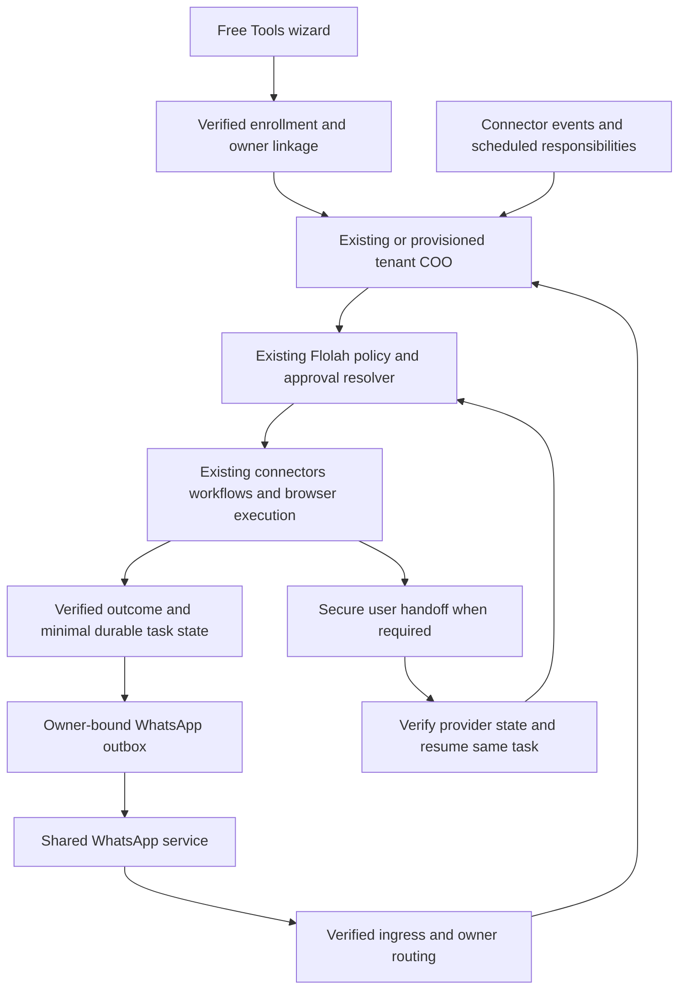

# FloAssist Analysis Design and Single Phase Implementation Plan

Status: the QR-linked FloAssist implementation is present in the working branch as of 24 October 2026. See [implementation and test evidence](FLOASSIST-IMPLEMENTATION-AND-TESTING.md) for the implemented behavior, prerequisites, test commands and limitations. It has not been deployed or validated against live provider accounts.

**Latest channel decision overrides the shared-service-number design below:** the user links their own pre-existing, separate dedicated WhatsApp number by scanning Flolah's native channel QR. Their personal number is the allowlisted recipient. The existing owner-specific COO channel implementation handles inbound messages, identity and replies. There is no additional shared-number webhook or new WhatsApp provider integration in this implementation.

**Privacy limitation:** the native channel and COO retain their normal Flolah/WhatsApp conversation, task and audit records. The implementation does not fulfill the earlier end-to-end transient-only processing target. The onboarding page explicitly discloses this. The original sections and 100-case matrix below remain the wider design/acceptance target; their presence does not mean all those cases have executed or passed.

FloAssist is a free WhatsApp personal assistant for consumers and professionals in Singapore, India, and Indonesia. It configures the user's Flolah COO, using Flolah accounts, connectors, skills, policies, approvals, workflows, schedules, and task execution. New users enter through Free Tools and complete a lightweight onboarding wizard. Full Flolah login and management remain optional. Existing users receive an additive uplift to their existing COO.

## 1 Agreed scope and product contract

- One FloAssist service number, with each verified user routed to their own Flolah owner and COO runtime.
- New account provisioning and connector ownership happen behind onboarding. No password, company setup, API key, agent hiring, or dashboard visit is required for ordinary use.
- Existing account ownership must be verified before linking. Reuse its owner ID, COO, connections, and policy configuration. Do not create a second personal workspace.
- Gmail, Google Calendar, Outlook Mail, Microsoft Calendar, Google Drive, and OneDrive are selectable during onboarding. Multiple connections require an explicit default for each capability.
- Conversational tasks, one-off and recurring reminders, email and file assistance, browser work, bookings, and purchases are all in this release.
- Morning briefings, priority alerts, conflict monitoring, deadline tracking, and follow-ups are all included. Users can individually pause and configure them.
- Advisory is the default experience for new users. Managerial and Administrative are configuration presets over Flolah policy; the effective action policy is authoritative.
- External actions default to approval required. Financial/destructive actions retain the platform's prohibited default until configured otherwise. If the effective financial/destructive policy is Autonomous, FloAssist may complete supported transactions autonomously. There is no unconditional payment-handoff rule.
- When policy or provider interaction requires the user, send a WhatsApp link and preserve task continuity. Provider login, OTP, CAPTCHA, or payment authentication can require handoff even with autonomous permission.
- Source content is transient by default; minimal task state persists. Long-term personal memory is opt-in.
- Service access is free with fair-use limits. Merchant purchases remain payable by the user; free service does not mean free goods or bookings.

One implementation phase means one integrated release containing this full scope. The work packages below are execution order and dependencies, not separate product phases or deferred features.

## 2 Existing implementation analysis

### Account and COO reuse

[users.js](../backend/src/services/users.js) implements `registerCeoUser`, personal industry defaults, standard agent grants, tenant initialization, model settings, and legal acceptance. It currently requires email, password, and name. [auth.js](../backend/src/routes/auth.js) invokes account registration and tenant provisioning. [ceo-openclaw-provision.js](../backend/src/services/ceo-openclaw-provision.js) provisions granted tenant runtimes, tool credentials, allowlists, and organization context. [openclaw-tenant.js](../backend/src/services/openclaw-tenant.js) synchronizes assigned skills.

Reuse these primitives through a verified passwordless registration path. Extract common account initialization rather than supplying a shared or invented user password. Resolve the user's entitled COO from platform data and runtime identity; do not assume a static agent ID or display name. Registration currently tolerates some provisioning failures, so FloAssist activation needs an explicit readiness checklist and retryable provisioning state.

### Free Tools entry

The public catalog is [free-tools/index.html](../deploy/static/flolah-home/free-tools/index.html), with a second tool surface in the [public home page](../deploy/static/flolah-home/index.html). Digital Adoption demonstrates a Free Tools experience with a separate email-code session and optional Flolah management; see [its user guide](../docs-site/docs/systems/digital-adoption.md). Reuse the interaction pattern, while binding FloAssist identity to an actual Flolah owner. Do not couple FloAssist authentication to Digital Adoption's service database.

### Existing policy is the authority

[action-policy.js](../backend/src/services/action-policy.js) already implements read, internal write, external communication, and financial/destructive families; autonomous, approval-required, and prohibited modes; and owner-scoped overrides. The documented override order is goal, workflow, agent, tool, then company fallback. Preserve that resolver rather than introducing a competing policy engine. [chat-action-approval.js](../backend/src/services/chat-action-approval.js) binds decisions to owner, action, arguments, expiry, and execution state. [policy documentation](platform-help/10-policies-guardrails.md) describes bounded recurring grants.

Browser operations already identify purchase, payment, order submission, and deletion as financial/destructive effects. The inspected amount constraint compares a numeric amount; a cross-currency purchasing contract must additionally bind currency and final total. Extend the existing constraint machinery where needed, keeping approval and execution in the same policy path.

### Connectors and proactive events

[event-productivity.js](../backend/src/services/event-productivity.js) provides capability bindings and normalized email, calendar, and file events. [event-productivity-listeners.js](../backend/src/services/event-productivity-listeners.js) provides provider listener infrastructure. [the implementation reference](EVENT-PRODUCTIVITY-PACK-V1.md) documents deduplication, retries, owner-scoped targets, minimal receipts, and exact provider action bindings. Use this for the five proactive responsibilities.

[connector-action-grants.js](../backend/src/services/connector-action-grants.js) contains agent-keyed grants in the shared schema and legacy broad-access behavior when no grants exist. FloAssist must not use a shared COO catalog ID to change every user's permissions or accidentally change an existing user's broad grants to a reduced allowlist. Add owner-scoped connector grants with explicit compatibility handling, and prove owner isolation. [agent-skills.js](../backend/src/services/agent-skills.js) already has owner-and-agent-scoped skill assignments; use its versioning and assignment path.

### WhatsApp and browser continuity

[ceo-agent-channels.js](../backend/src/services/ceo-agent-channels.js) implements tenant channel setup using WhatsApp session pairing. [channel-user-identity.js](../backend/src/services/channel-user-identity.js) resolves actors within a known owner. Neither alone establishes the new shared-number lookup from a verified sender to the correct owner. Add that ingress routing adapter; then use existing owner/actor checks. [agent-channel-announce.js](../backend/src/services/agent-channel-announce.js) is the existing outbound delivery integration point.

[browser-tasks.js](../backend/src/services/browser-tasks.js) preserves task steps and resumes blocked tasks. That is a useful foundation, but it is not evidence of transferable merchant checkout sessions or a mobile remote-browser handoff. Build and test those continuations explicitly. Existing [connector execution policy](../backend/src/services/connector-execution-policy.js) avoids retrying writes after ambiguous failures; preserve this behavior for purchases.

### Privacy and persistence

[data-retention.js](../backend/src/services/data-retention.js) currently uses 30, 60, 90, 120, or 365 days, with 90 days as default. [channel documentation](platform-help/24-agent-channels.md) describes durable attachment mirroring into Content Explorer. These mechanisms do not constitute transient processing. FloAssist must carry its processing profile through connector results, agent prompts, browser traces, attachments, workflow outputs, and telemetry. Existing users' unrelated COO history and company knowledge remain under their established settings.

## 3 User journeys

### New user from Free Tools

1. Open the FloAssist card and choose Get started. Enter email and phone; show service terms, data handling, and proactive WhatsApp opt-in. Infer country and timezone only as suggestions; confirm the timezone because Indonesia spans multiple zones.
2. Verify email with a short-lived code or link. Verify the WhatsApp identity using a one-time onboarding challenge sent from the declared phone to the service number, or the chosen provider's verified equivalent. Never bind an account merely from typed contact details.
3. Establish a restricted onboarding session. Provision the personal Flolah owner and resolve/provision its COO in the background after verified consent. Repeated callbacks and refreshes resume the same enrollment.
4. Select connectors and complete OAuth. Explain requested actions and allow skipping/retrying individual connections. Provider credentials remain in the existing connector runtime. Bind the exact connected account and capabilities to the user.
5. Review autonomy. Start in Advisory with no autonomous changes to connected systems. Show existing Flolah settings for approval-required actions and financial/destructive restrictions. Choose presets or individual settings; preview effects before saving through existing policy services.
6. Enable all five responsibility templates, subject to user selection and available capabilities. Configure briefing time, quiet hours, priority contacts, preferred calendar, and optional monitored folders/labels. Use sensible editable defaults so onboarding stays short.
7. Confirm transient processing and optional memory. Activate only after identity, COO runtime, messaging route, and minimum selected capability readiness succeed. With no connectors, activate reminders and general assistance and show which responsibilities await a connection.
8. Send a welcome message and a first-task suggestion. The web completion page can close. Flolah account management is an optional link, not a mandatory redirect or company-setup gate.

### Existing Flolah user

After verification, link to the existing owner and entitled COO. Existing MFA requirements still apply to account linking; this can be a brief embedded verification without a dashboard visit. Preserve existing connectors, grants, model preference, persona, skills, policies, workflows, schedules, and channel bindings. Display the current effective settings, including a Custom label when they differ from a preset. Offer only explicit changes; do not silently reset an autonomous account to Advisory.

Apply the assistant skill pack additively, with assignment provenance and version. Reuse compatible connections and subscriptions, with a reference to their original ownership. Avoid duplicate briefings or alerts when an equivalent responsibility already exists. Handle no-COO and multiple-COO cases through entitlement/readiness resolution rather than picking a name. Organization delegates must not silently acquire ownership of a CEO account; use existing roles and require an entitled owner for enrollment.

### Ordinary WhatsApp use

Support natural requests and clear control intents: remind, reschedule, snooze, list reminders, pause all, resume, connect an app, change preferences, review permissions, forget a remembered fact, and stop the service. Bind approvals to task IDs/buttons when multiple requests are pending. If a text reply such as Yes is ambiguous, ask which task. Status questions never restart purchases or other work.

Connecting an app, updating identity, reviewing broad permissions, or taking over a browser may open a secure lightweight page. Ordinary tasks and replies remain in WhatsApp. A request to open full Flolah management exchanges a verified session through the existing authentication boundary; do not put broad login tokens into chat URLs or bypass account MFA.

## 4 Architecture and execution contracts

The FloAssist layer owns enrollment, channel routing, product preferences, entitlement/budget checks, handoff state, and data-processing context. Flolah continues to own agents, skills, source credentials, execution, policies, approvals, schedules, and durable work outcomes.

Every incoming message and background job carries a trusted owner ID, actor identity, resolved COO runtime ID, source message/event ID, conversation/work ID, processing-profile version, and applicable policy scope. Derive these from authenticated records, never from a model-supplied owner ID. Revalidate connection ownership and current policy before each side effect and after every human handoff.

### Shared WhatsApp transport

Implement an adapter with verified inbound-message handling, send-message, send-template where applicable, media retrieval, and delivery-status callbacks. Verify provider signatures before sender resolution. Persist provider message IDs for deduplication; acknowledge accepted delivery promptly and execute through bounded per-owner queues. Serialize conflicting actions on the same work item while allowing unrelated reads.

Keep the service account credentials platform-owned. Bind the verified sender to exactly one active enrollment for this service route. Unknown senders get enrollment help without account disclosure. Phone changes require verification of the new binding and revocation of old sessions; ambiguous ownership or reassigned numbers trigger re-verification. Never route replies through a global last-active COO.

Use an outbox with owner, work ID, recipient binding version, message type, retry status, and dedupe key. Recheck recipient and enrollment state before delivery. Distinguish accepted, sent, delivered, and failed states. Business Platform rules, if that is the approved transport, require templates outside its customer-service window. Keep user opt-out, template failure, and channel outage behavior explicit.

### Policy semantics and payment behavior

Preset names describe configuration; they do not create independent authority. Advisory means reading and proposing by default. A source-system mutation is possible only through the configured approval-required path with a valid approval, or an explicit change to an autonomous setting. A prohibited action remains blocked. Internal reminder state and consented messages to the owner need narrowly scoped permissions so Advisory can function without permitting email to other recipients.

Managerial exposes creation, updates, and external communication settings; Administrative additionally exposes deletion settings. Selecting either does not silently enable financial activity. Show the resolved financial/destructive mode separately. Preserve the existing goal/workflow/agent/tool/company precedence, including intentional scoped exceptions. Existing user overrides remain effective unless the user changes them.

Before a booking or purchase commitment, resolve the actual operation, merchant, final amount, currency, cancellation terms, recipient/traveler identity, and idempotency reference. A zero-cost reservation is still an external commitment. Do not classify a checkout or order button as navigation merely because it is reached through the browser.

- **Prohibited:** do not execute the commitment. The user may still receive research and a normal merchant link to act independently; opening it does not grant FloAssist permission.
- **Approval required:** present the exact commitment in WhatsApp. A valid approval authorizes only that operation. Use a payment or browser link when the user needs to authenticate or complete the transaction.
- **Autonomous:** execute when the tool/provider supports it and all effective constraints are satisfied. Do not add an obligatory human-payment step. Authentication challenges or unavailable provider capabilities still lead to handoff.

Extend the canonical constraint contract with amount in minor units, currency, merchant identity/domain, and total including taxes/fees as needed. Financial approval and autonomous budget checks must use the final quote. Do not infer conversion between SGD, INR, and IDR or reuse a numerical cap across currencies. If a refreshed quote violates a bound, obtain a new authorization or stop according to policy.

### Durable handoff and continuation

Represent the interaction as a linked work item with states `researching`, `prepared`, `awaiting_approval`, `awaiting_user`, `executing`, `verifying`, `completed`, `failed`, `cancelled`, and `expired`. Store this as an extension/reference to the existing goal/browser work, not a second competing execution engine. Track transition version, executor lease, and verification outcome to prevent two resumptions from committing twice.

Prefer a provider-generated checkout or reservation URL. If unsupported, issue an authenticated FloAssist handoff to the isolated browser context. If a site supports neither, provide its legitimate link and retain selected-option details; clearly state when the prepared cart cannot transfer. Do not promise universal browser automation or successful checkout on every merchant.

A handoff token is hashed at rest, short-lived, owner/task/purpose-bound, and exchanged for a scoped session. Opening the URL does not approve or resume work. Link previews and scanners must be harmless. Require authenticated confirmation for a sensitive continuation; use no-referrer pages and redact tokens from access logs. For browser takeover, suspend agent input and transfer an exclusive lease; restore agent control only after the user finishes or the lease expires. Do not expose other tabs, files, owners, or browser profiles.

After user completion, verify using an authenticated provider callback, provider lookup, confirmation page, or an authorized receipt lookup. A message saying Paid starts verification; it is not proof. On uncertain write outcome, reconcile before retrying. Notify once when verified, then schedule or update related tasks under their own policies. Expired quotes, abandoned checkout, cancellation, and revoked access are terminal or re-planning transitions, never blind resubmissions.

### Proactive responsibilities and reminders

Implement all five as versioned templates using existing scheduled goals and event subscriptions:

1. **Morning briefing:** one local-time schedule aggregates agenda, selected priorities, outstanding deadlines, and follow-ups. Display unavailable sources honestly.
2. **Priority alerts:** email events plus configured people/topics feed a significance check, with deduplication and a daily interruption allowance.
3. **Conflicts:** calendar changes trigger overlap and availability checks across selected calendars. Suggest resolution in Advisory; reschedule only under effective policy.
4. **Deadlines:** authorized email/document reads produce a minimal candidate with source reference, due time, confidence, and user correction path. Ask on consequential ambiguity before creating a reminder or commitment.
5. **Follow-ups:** track user-selected threads or explicitly enabled rules, detect replies, close resolved items, and remind or send follow-ups according to policy.

Use provider event support when available and existing listeners/reconciliation otherwise. Establish a baseline so onboarding does not flood users with historical alerts. Bound scans and apply backoff. Persist event/object versions and task correlations; renewing subscriptions or replaying events must not duplicate reminders, bookings, or messages. Source content is untrusted data, not instructions to change policies or disclose another connector's data.

Reminders need durable one-off and recurring due times, timezone, snooze/cancel, restart recovery, and deduplicated delivery. Confirm whether existing scheduled-goal support covers each operation; add missing one-off behavior to the shared scheduling infrastructure. Handle ambiguous natural-language times with clarification, and use IANA timezones including Asia/Singapore, Asia/Kolkata, and the user's selected Indonesian zone. Quiet hours defer routine alerts; explicit reminder timing and configured urgent exceptions determine interruptions.

### Privacy and memory

Introduce a processing context on every FloAssist task, including existing-user tasks entered through this channel. Reuse the same COO with a bounded conversation context: do not automatically ingest the existing company archive into a new personal request. Explicitly authorized source retrieval can still use existing user data.

Proposed defaults, configurable in the product profile:

- Raw connector text, attachments, screenshots, and browser traces: memory-only where possible; encrypted temporary material where needed, removed on task completion with a maximum 24-hour TTL. Do not include it in backups or indexes.
- Handoff continuity: persist references, selected options, and the minimum user-visible transaction summary. Refetch source content after restart instead of keeping full pages or mailboxes.
- Chat continuity: a rolling 24-hour raw-context window for FloAssist conversations, followed by deletion; keep only explicitly saved memory and minimal active-task facts. Show this behavior during onboarding.
- Active reminders, commitments, and follow-ups: retain necessary facts until closed or cancelled. Retain minimal terminal task/receipt metadata for 30 days by default, subject to the user's applicable retention and required records. These facts are data, even when summarized.
- Credentials: remain in the existing encrypted connector/vault path until disconnected or revoked. They are not transient task content.
- Personal memory: off by default, explicit save/edit/delete and provenance; no automatic embedding or company-memory capture from FloAssist conversations.

The TTL values are design defaults, not claims about existing behavior. Implement filtering before durable writes, not only a purge job. Audit OpenClaw transcripts, Brain/workflow outputs, approval `args_json`, Content Explorer mirrors, browser profiles/downloads, errors, telemetry, caches, model-provider retention, indexes, and backups. Approval records should reference encrypted expiring arguments where raw content is necessary, preserving exact-action hashing without indefinite plaintext copies. Metadata and summaries must be minimized and treated as personal data.

Explain separate actions: pause assistant, disconnect a connector, forget memory, delete FloAssist data, and delete the Flolah account. Disabling FloAssist for an existing user removes only FloAssist-owned responsibilities/assignments and leaves shared assets intact. Revoke relevant pending work before deleting its data so it cannot be recreated by an old job. Data already delivered to WhatsApp or a merchant follows those services' retention; do not promise erasure of external copies.

### Free usage and regional behavior

Store per-owner and platform-wide quotas for model spend, browser runtime, background checks, and outbound messages in configurable product/admin data. Use the existing model routing system and platform-funded entitlement for the free path; new users must not supply a key. Existing users retain their selected model settings, with the funding source made explicit if their BYOK is used. Do not silently switch existing paid configurations.

Reserve budget before work, reconcile after completion, and prevent concurrent jobs from overspending. Degrade expensive scans into digest mode or pause them with a clear notice. Preserve stop, cancel, connection recovery, and safety-critical transaction-status reconciliation when ordinary quotas are exhausted. A limit must not leave a possibly completed payment to be retried later without verification. Select numerical caps from measured canary costs before release; do not market unlimited service.

Treat country, timezone, language, and currency as separate preferences. Initial UI copy can be English with a localization-ready structure; support user-selected conversational language subject to model testing, without promising unvalidated language coverage. Use explicit dates, international phone normalization, local-time summaries, and currency-labelled prices. Record country-specific provider availability and delivery results for all three launch markets.

## 5 Data and API design

Names below are proposed; existing equivalent tables/services should be extended rather than duplicated. Use the repository's established database boundary deliberately: global enrollment routing requires a platform registry; work payloads follow the owner's current shared/tenant storage configuration.

- `floassist_enrollments`: unique owner/product enrollment, verified identity binding reference, resolved COO, onboarding/readiness state, product version, consent versions, privacy-profile version, preferences, lifecycle timestamps.
- `floassist_identity_bindings`: service route, provider sender ID, encrypted contact value where needed, lookup fingerprint, owner, verification/version/revocation timestamps; uniqueness for active sender bindings. Do not expose sequential account identifiers publicly.
- `floassist_onboarding_sessions`: hashed credentials/challenges, purpose, expiry, verification attempts, verified owner linkage, resumable step state. Authentication challenges never store plaintext codes.
- `floassist_resource_links`: enrollment, existing skill assignment/subscription/schedule/connection/work ID, created-versus-reused provenance, version. This enables additive uplift and safe opt-out.
- `floassist_handoffs`: owner/work/browser references, state/version, quote fingerprint, expiry, hashed token, verification status, and minimal provider references. Do not store card numbers, CVV, or OTPs.
- `floassist_message_outbox`: owner, enrollment/binding version, source work/event, provider message ID, delivery lifecycle, dedupe key, retry/expiry metadata. Payload bodies follow the transient policy.
- `floassist_usage`: reservations and settled usage by dimension, owner, and billing window, linked to existing accounting where available.

Keep existing policy, approvals, event inbox, scheduled goals, skills, and connector credentials canonical. Product tags and capability mappings are data-driven. No hardcoded COO names, provider action IDs, merchant domains, production origins, model names, or numerical quota settings in core logic.

Proposed routes:

- `POST /api/floassist/onboarding/start`, `/verify-email`, `/verify-phone`, `/complete`; `GET /api/floassist/onboarding/status`.
- `GET /api/floassist/connections`; `POST /api/floassist/connections/:provider/authorize`; provider callback routes using existing connector OAuth services and state/nonce binding.
- `GET/PATCH /api/floassist/preferences`; `GET /api/floassist/policy-preview`; policy writes delegate to existing policy APIs with authenticated owner context and MFA where required.
- `GET/POST /api/floassist/webhooks/whatsapp` for provider verification/inbound delivery, plus delivery status handling appropriate to the selected provider.
- `GET /api/floassist/handoffs/:id` for scoped review; `POST .../exchange`, `.../complete`, and `.../cancel` for authenticated state changes. GET requests are side-effect free.
- `POST /api/floassist/pause`, `/resume`, `/disconnect`, `/forget`, and `/account-access` with purpose-specific authorization.

Use standard error classes for verification needed, connection expired, policy prohibited, approval needed, quote expired, uncertain provider outcome, quota reached, and channel unavailable. Do not expose account existence on public enrollment endpoints. Server-derived ownership is mandatory on every resource read or write.

## 6 Single phase execution plan

### Work package 1 Establish provider and integration contracts

Owner role: platform integration lead. Dependencies: none.

Confirm the permitted shared-number WhatsApp transport for this product and all three countries, provider callbacks, proactive-message rules, pricing, and media behavior. Document the actual provider adapter contract and test credentials. Inventory exact connector capabilities against the deployed catalog and validate supported checkout/handoff mechanisms with representative merchants. Record the funding/model route, privacy processor settings, and proposed quotas.

Deliverable: configuration manifest and executable provider fixtures. Exit: transport and catalog assumptions are evidence-backed, or named external blockers are recorded; no unsupported country capability is represented as ready. Other implementation work can proceed against fixtures, but launch cannot bypass this dependency.

### Work package 2 Implement enrollment and existing COO uplift

Owner role: backend identity engineer. Dependencies: integration identity contract.

Add versioned enrollment schema, restricted sessions, email/phone verification, and idempotent background provisioning. Extract reusable registration initialization from `users.js`; add a passwordless credential path and later optional account-access enrollment without weakening existing MFA. Resolve and reuse the entitled COO. Record readiness and compensating cleanup for partial failures. Add provenance for product-owned assignments and resources.

Primary changes: `backend/src/services/users.js`, `routes/auth.js`, `services/ceo-openclaw-provision.js`, new `services/floassist-enrollment.js`, `services/floassist-identity.js`, and `routes/floassist.js`.

Exit: a new user and an existing user both enroll without duplicate owners or COOs; retries and concurrent callbacks converge; existing settings remain intact; no dashboard visit is required.

### Work package 3 Deliver Free Tools onboarding and optional management

Owner role: frontend engineer. Dependencies: enrollment and connector contracts.

Add the FloAssist card and public landing/wizard at `/free-tools/floassist/`. Implement identity verification, connector checkboxes and OAuth continuation, policy previews, responsibility preferences, privacy choice, and completion. Use a restricted product session and same-origin API routing. Provide secure lightweight settings and optional full-Flolah management access. Account for mobile browsers, OAuth popup/redirect failures, back navigation, expired sessions, and accessibility.

Primary changes: `deploy/static/flolah-home/free-tools/index.html`, `deploy/static/flolah-home/index.html`, new `deploy/static/flolah-home/free-tools/floassist/`, API/deployment route configuration, and relevant connector/policy UI integration.

Exit: the complete mobile journey works from Free Tools to the first WhatsApp task, including partial connection failure and resumed onboarding.

### Work package 4 Connect shared WhatsApp to tenant COO execution

Owner role: messaging backend engineer. Dependencies: verified enrollment and provider transport.

Build signed webhook ingress, sender-to-owner lookup, conversation binding, dedupe, queueing, approvals, delivery outbox, opt-out, and status reconciliation. Integrate existing actor authorization, chat approval, COO runtime execution, and outbound announce paths. Preserve existing tenant-paired WhatsApp channels. Add bounded media handling through the privacy profile.

Primary changes: new `services/floassist-whatsapp.js`, `services/floassist-outbox.js`, `routes/floassist-webhooks.js`; integrate `channel-user-identity.js`, `chat-action-approval.js`, and `agent-channel-announce.js`.

Exit: two users interleave messages and approvals without cross-routing; duplicate callbacks execute once; outages/restarts recover; messages after opt-out are suppressed.

### Work package 5 Bind connectors skills and all proactive responsibilities

Owner role: platform automation engineer. Dependencies: enrollment, owner scoping, messaging.

Add owner-scoped connector grant compatibility and automated capability binding from validated live catalog metadata. Create a versioned assistant skill pack with tags such as personal assistance, email, calendar, files, reminders, browser, bookings, and purchase continuity. Assign to the resolved COO using existing skill APIs; merge rather than replace existing assignments. Configure all five responsibility templates through existing event and scheduled-goal services. Add missing one-off reminder behavior to shared scheduling if needed.

Primary changes: `connector-action-grants.js`, `agent-skills.js`, `platform-skill-catalog.js`, `event-productivity.js`, `event-productivity-listeners.js`, `scheduled-goals.js`, and proposed `services/floassist-responsibilities.js` plus versioned skill/template data.

Exit: each responsibility demonstrates an event-to-outcome path on Google and Microsoft fixtures; baseline and replay do not duplicate work; live capability probes confirm the selected provider actions.

### Work package 6 Implement booking purchase and browser continuation

Owner role: browser and transaction engineer. Dependencies: policy context, messaging, owner-scoped browser execution.

Add task-linked handoff records, mobile review/continuation pages, provider links, exclusive browser takeover, final-quote normalization, currency-aware constraints, and verified resumption. Reuse existing browser pause/resume and approvals. Ensure autonomous financial policy completes supported actions without an extra payment gate; preserve required provider authentication. Handle no-cost bookings, approval expiry, quote changes, uncertain outcomes, cancellations, and refunds with effect-appropriate policies.

Primary changes: `browser-tasks.js`, `routes/browser-session.js`, `action-policy.js`, `chat-action-approval.js`, proposed `services/floassist-handoffs.js`, and public handoff UI.

Exit: prohibited, approval-required, and autonomous transaction cases all behave correctly; mobile handoff continues the same task; duplicate clicks and delayed callbacks cannot create a second commitment.

### Work package 7 Enforce transient processing and free-service budgets

Owner role: platform data/runtime engineer. Dependencies: all execution contracts; implemented across earlier packages, completed here.

Thread the processing context through COO prompts, workflows, connector results, browser traces, media, approvals, and logs. Add encrypted temporary payload references, deletion sweeps, memory opt-in controls, and FloAssist-specific conversation boundaries. Implement quota reservation, settlement, digest degradation, platform-funded model routing, and continuity exemptions. Add operational metrics without raw content.

Primary changes: `data-retention.js`, relevant content/media and workflow persistence services, existing model/budget routing, proposed `services/floassist-processing-profile.js` and `services/floassist-usage.js`.

Exit: seeded sensitive content disappears from controlled stores within the promised window; existing non-FloAssist history remains intact; budget races cannot overspend; pending transaction verification survives quota exhaustion.

### Work package 8 Validate and release the complete scope

Owner role: release engineer with feature owners. Dependencies: all prior packages complete.

Run deterministic contract suites, browser/mobile end-to-end checks, provider sandboxes, and authorized live canaries across all three countries. Publish user help, troubleshooting, data-handling disclosures, provider capability limitations, and operational runbooks. Release behind a server-controlled enrollment flag, then open the Free Tools card when all gates pass. A controlled rollout is validation of the same complete release, not a smaller feature phase.

Exit: every acceptance scenario below passes or the release remains explicitly blocked by a named external prerequisite. No release claim based only on mocked integrations.

### Dependency order and sizing

Critical path: provider contract and identity → enrollment and owner-scoped routing → connector/policy integration → payment continuity → integrated validation. UI, responsibility templates, and privacy hooks can be developed alongside the relevant backend contracts; this describes work organization, not authorization to spawn agents or separate chats.

Planning estimate: 40–60 engineering days plus 8–12 QA/release days, assuming existing services are reusable as inspected and provider access is available. With three engineers and QA overlap, allow approximately 5–7 calendar weeks. This is an estimate, not a commitment; merchant/browser compatibility and provider eligibility can extend elapsed time. All agreed capabilities remain within the one release.

## 7 Acceptance and verification

1. **New signup:** email plus phone verification creates one owner, links one COO, connects selected services, and reaches WhatsApp without full Flolah login. Partial provisioning resumes after a restart.
2. **Existing uplift:** the same owner and COO IDs remain; existing policies, persona, connector access, skills, schedules, and history survive. Repeated enrollment adds no duplicate resources.
3. **Isolation:** two owners share the service number but cannot see each other's messages, approvals, connections, files, browser sessions, or handoffs. Test both shared-DB and tenant-DB account modes.
4. **Policies:** source-system reads work in Advisory; mutations require the configured path. Prohibited actions reject grants; approval-required actions execute only the exact approved arguments; autonomous actions execute within configured bounds. Test scope precedence and policy changes while work is pending.
5. **Payments:** test SGD, INR, and IDR; final fees; expired/changed quotes; permitted and disallowed merchants; autonomous execution; provider authentication; failed verification; duplicate callbacks; and ambiguous network timeouts. No duplicate commitment.
6. **Bookings:** paid and zero-cost reservations, attendee identity, cancellation terms, abandoned handoff, and confirmation-to-calendar continuation each follow the correct policy.
7. **Browser:** mobile takeover preserves the right session, stops agent input, and safely returns control. Link preview, expired token, wrong user, missing worker, and browser restart cases are covered.
8. **Connectors:** Gmail/Google Calendar/Drive and Outlook/Microsoft Calendar/OneDrive work through exact owner bindings. Cover expired OAuth, missing scope, multiple accounts, disconnect, and action catalog changes.
9. **Proactivity:** all five responsibilities produce useful outcomes; baseline scans avoid alert floods; event replay and schedule restart produce no duplicates; quiet hours and timezone boundaries behave correctly.
10. **Reminders:** one-off, recurring, snooze, cancellation, missed-delivery recovery, and ambiguous-time clarification work through WhatsApp.
11. **Privacy:** seed distinctive content and inspect transcript, workflow, approval, event, browser, media, log, cache, index, and backup paths. Confirm TTL deletion and memory opt-in; verify existing company data is unaffected.
12. **Free usage:** concurrent reservations respect limits; expensive work pauses clearly; control commands and uncertain-transaction reconciliation remain available; no unexpected user charges.
13. **Lifecycle:** pause, resume, opt-out, phone change, reconnect, selective forgetting, FloAssist deletion, and optional account access are tested. Product removal does not delete shared Flolah resources.
14. **Regional delivery:** record actual delivery/continuation outcomes for Singapore, India, and Indonesia with the selected provider, including proactive messaging and local-time scheduling.

Run the existing relevant backend suites: `test:action-policy`, `test:notify-approval`, `test:security:tenant-tools`, `test:event-productivity-pack`, `test:event-productivity-agentic-binding`, `test:event-productivity-listeners`, `test:agent-skills`, `test:browser-executors`, `test:browser-task-routing`, and `test:browser-maturity`, plus frontend build. Add focused FloAssist suites for enrollment, routing, existing-user uplift, handoffs, privacy, and budgets. Run against isolated fixture databases. Real purchases require a separately authorized live test or provider sandbox; a harness is not live-payment evidence.

### 7.1 Test scope and execution classification

The catalogue below contains **100 base test cases**, with additional mandatory provider, policy, currency, country, and account variants. It covers functional behavior, integration contracts, identity/security boundaries, privacy, recovery, concurrency, performance, accessibility, and operational release. These are specifications, not executed results. All FloAssist-specific cases initially have status `PLANNED`; no provider credentials, test accounts, or deployed FloAssist environment have been verified by this planning exercise.

Each case lists priority and required execution level. Prerequisites listed at the group level apply to **every case in that group**, plus any case-specific additions. Every case requires PR-01 and PR-02. A missing prerequisite means `BLOCKED` with its prerequisite ID; it never means pass or not applicable. An arrow such as `I→S` means run at both levels and keep separate results. It does not allow replacing the sandbox run with a simulated result.

Execution levels:

- **U — isolated unit/contract:** disposable database, fake clock, synthetic identities, mocked providers, controlled model/tool outputs; external network denied. No real OAuth, WhatsApp, or merchant account required.
- **I — integrated local/staging:** actual FloAssist API, UI, tenant runtime, workers, scheduler, storage, and policy services; provider and merchant simulators are allowed and must be identified. Requires PR-06 in addition to group prerequisites. Use a deterministic model adapter where the case measures control flow rather than model quality.
- **S — provider sandbox/test tenant:** actual external OAuth/provider APIs, delivery callbacks, or merchant sandbox, using isolated test identities and approved test destinations. Requires PR-06 and the relevant provider prerequisites. Where a provider offers no sandbox, a dedicated test tenant is still a real external environment; record that fact and control its side effects.
- **L — controlled live canary:** production-compatible transport and real regional endpoints/accounts. Requires PR-06, PR-16, and each provider prerequisite. Any charge, message, booking, or deletion has an explicit authorized target, cap, and cleanup plan. A product policy set to Autonomous is a test input, not authorization for the tester to spend real money.

Priorities:

- **P0 — release blocker:** account takeover, cross-owner access, wrong recipient, unauthorized or duplicate commitment, policy bypass, incorrect financial outcome, or violation of the promised data deletion boundary.
- **P1 — required product behavior:** every other agreed user journey, connector, responsibility, recovery path, and operational requirement.
- **P2 — noncritical presentation refinement:** can be logged separately, but cannot be used to downgrade a missing agreed capability. All catalogue cases are P0 or P1.

Use `PLANNED`, `READY`, `RUNNING`, `PASS`, `FAIL`, `BLOCKED`, and `NOT_APPLICABLE` as run states. `READY` requires evidence for every prerequisite; `PASS` requires all listed assertions and cleanup. `NOT_APPLICABLE` is permitted only for a genuinely unsupported variant with a documented product contract, never to remove an agreed connector, market, policy mode, or feature. A case with required live variants remains incomplete until those variants pass.

### 7.2 Prerequisite register

Record each prerequisite's owner, environment, readiness state, evidence location, expiry/revalidation date, and blocking case IDs in the execution manifest. The classes below separate what engineering can prepare locally from platform configuration, external dependencies, and authorized live operations.

- **PR-01 — Implemented build and migrations. Class: engineering readiness. Owner: feature leads.** A pinned commit containing the features under test, versioned database migrations, rollback compatibility, dependency lockfiles, and declared feature flags. Evidence: build ID, migration report, and tested schema versions. Current state: **not ready for FloAssist tests; this is a design-stage plan**. Existing regression suites can run independently against the existing build.
- **PR-02 — Isolated harness and test-run evidence. Class: local tooling. Owner: QA/platform.** Supported Node/runtime and dependencies, disposable data/workspace/config directories, process-local configuration, fake clock where applicable, controlled network egress, assertion tooling, unique run ID, and cleanup. Evidence: environment health check and empty/seeded database fingerprint. Current state: not verified. Existing scripts that alter HOME or USERPROFILE must run only in an isolated subprocess; never change the operator's session or real workspace.
- **PR-03 — Owner and identity fixtures. Class: synthetic test data. Owner: identity engineer.** Owner A/B, new and existing owners, shared and tenant DB modes, same shared COO catalogue definition with different tenant runtimes, renamed COO, no/multiple COOs, disabled owner, delegate/nondelegate, email/phone verification states, and immutable pre-uplift snapshots. Evidence: seed manifest with synthetic identifiers, expected grants, and snapshot hashes. Current state: to prepare.
- **PR-04 — Policy and approval fixtures. Class: synthetic authorization data. Owner: policy engineer.** All action families/modes, scope precedence, exact-action approvals, expiry/use limits, recipients, merchants, currency/amount bounds, and pending-policy-change variants. Evidence: reviewed policy fixtures plus resolver preview output. Current state: existing policy infrastructure available in source; FloAssist variants to prepare.
- **PR-05 — Provider and event simulators. Class: deterministic integration tooling. Owner: integration engineer.** Email/OTP capture, OAuth callback simulator, WhatsApp signed-webhook simulator, Google/Microsoft catalogue and CRUD fixtures, fake merchant, receipt ledger, delayed/error callbacks, event duplicates/tombstones/pagination, and operation counters. Evidence: simulator version and scenario catalogue. Current state: to prepare or extend existing harnesses.
- **PR-06 — Integrated environment. Class: platform configuration. Owner: platform operations.** Isolated API/frontend, OpenClaw runtime, connector service, browser workers where used, scheduler, queues, database mode, vault keys, TLS/callback origin for external runs, and health checks. Evidence: sanitized configuration fingerprint, service readiness, and route probes. Current state: not verified for FloAssist. No production default database or production connector token is allowed in local tests.
- **PR-07 — Google and Microsoft test connections. Class: external provider access. Owner: connector administrator.** Configured OAuth applications and callbacks, correct consent/scopes, dedicated Gmail/Calendar/Drive and Outlook/Calendar/OneDrive accounts, personal-account and supported organization-account variants, fixture emails/files/calendars, and cleanup permissions. Evidence: successful consent and capability probes for exact catalogue IDs, with no secrets in the report. Current state: not verified; blocks real connector cases only.
- **PR-08 — WhatsApp provider setup. Class: external transport access. Owner: messaging administrator.** Eligible provider route for FloAssist, service number, signing credentials in vault, verified callbacks, test recipients and opt-ins, template setup where applicable, delivery-status capture, and separate test/live configuration. Evidence: provider confirmation, route identity, and successful inbound/outbound probes. Current state: provider eligibility/access unresolved; mock routing tests remain independent of it.
- **PR-09 — Browser and handoff environment. Class: execution infrastructure. Owner: browser engineer.** Isolated owner profiles, deterministic merchant pages, remote interactive session/takeover, downloadable and blocked-content fixtures, worker restart control, and credential-free traces. Evidence: browser health, profile-isolation probes, and mobile handoff reachability. Current state: existing browser primitives in source; FloAssist takeover configuration to implement/verify.
- **PR-10 — Transaction sandbox and oracle. Class: provider test data. Owner: transaction integration lead.** Sandbox merchant/booking APIs or controlled equivalent, test payment methods, SGD/INR/IDR quotes with fees and rounding, declined/pending/settled responses, idempotency support where available, cancellation/refund fixtures, and independent order ledger. Evidence: sandbox account, scenario IDs, and zero-real-charge confirmation. Current state: to select/configure. A fake merchant qualifies for I, not S or L.
- **PR-11 — Model and agent evaluation setup. Class: runtime/quality configuration. Owner: agent engineer.** Selected model route, funded test quota, versioned prompts/skills, frozen evaluation conversations, expected tool/action outcomes, and independent outcome checks. Evidence: model/config version and corpus revision. Current state: not verified. Deterministic stubs test enforcement; they cannot establish task understanding quality.
- **PR-12 — Privacy and data observability. Class: verification infrastructure. Owner: data/runtime engineer.** Inventory and inspectable test copies of transcripts, workflow results, approval arguments, event payloads, files, browser traces/profiles, caches, indexes, logs, exports, and backups; canary-string scanner; TTL clock/sweeper control; processor retention settings. Evidence: store inventory and scan/restore tooling. Current state: to prepare. Uninspectable paths are recorded as gaps, not assumed clean.
- **PR-13 — Regional and device access. Class: external UAT resources. Owner: QA regional coordinator.** Consenting test users/numbers in Singapore, India, and Indonesia, physical iOS Safari and Android Chrome with WhatsApp app/in-app browser, desktop browser, supported locale settings, and Indonesian timezone variants. Evidence: device/browser versions, country/route, timezone, and tester authorization. Current state: not verified. Device emulation does not replace physical-device sign-off.
- **PR-14 — Load and fault injection. Class: nonfunctional tooling. Owner: reliability engineer.** Bounded load generator, latency/error injection, process kill/restart controls, duplicate/reordered message support, metrics, resource caps, and stop switch in an isolated environment. Evidence: approved load profile and baseline measurements. Current state: to prepare; no load testing against third-party production services without their permitted arrangement.
- **PR-15 — Release and rollback assets. Class: operational readiness. Owner: release engineer.** Upgrade fixtures from the current schema, recoverable snapshots, feature flags, product-resource provenance, rollback runbook, alert destinations, and opt-out/deletion controls. Evidence: migration rehearsal and restoration drill. Current state: to prepare.
- **PR-16 — Live-test authorization and limits. Class: human/external authorization. Owner: product/release owner.** Explicit authorized recipients, accounts, merchant operations, spend/currency cap, cancellation/refund authority, test window, named operator, eligibility confirmation, and cleanup/reconciliation responsibility. Evidence: authorization record linked to the run. Current state: not provided by this planning request. Read-only canaries still require control of the test accounts and approved access; financial writes require operation-specific authorization.
- **PR-17 — Frozen acceptance configuration. Class: product decision/configuration. Owner: product and QA.** Chosen TTLs, memory behavior, timezone/quiet-hour defaults, supported languages, quotas, timeout/retry limits, and measured performance targets. Evidence: versioned expected-values manifest. Current state: proposed defaults exist in this plan; final operational limits and targets to freeze before acceptance execution. A test cannot pass by changing its threshold after observing failure.

Prerequisite dependency rules: PR-01/02 are universal for new cases; PR-03/04/05 enable most deterministic cases without external credentials. PR-06 enables full integration. PR-07/08/10 enable their provider-specific runs. PR-13/16 are additional live/regional gates. PR-12 is mandatory for any privacy claim; PR-14/15 for reliability and release claims. External access failures block the affected provider runs while local implementation tests continue.

### 7.3 Fixture variants and evidence contract

All fixtures use synthetic content and unique resource prefixes. The owner corpus includes different owners sharing a COO catalogue ID, not only different agent IDs. Seed recognizable synthetic secrets and unrelated company-history facts for leakage detection. Keep a pristine existing-owner snapshot and compare semantically meaningful state before/after uplift, ignoring only legitimate timestamps and new FloAssist-owned resources.

Mandatory variant rules:

- **Identity/isolation:** new and existing owners; shared and tenant DB; two owners interleaving requests; owner disabled/revoked during work. Apply to FA-001–020, FA-036–040, FA-056–065, and FA-091–095 where relevant.
- **Connectors:** Gmail, Google Calendar, Google Drive, Outlook Mail, Microsoft Calendar, and OneDrive each require authorize/read/disconnect/expired-token coverage. Exercise writes only for the service's selected and granted capabilities. Run supported personal and organization-account variants, plus two accounts of the same provider.
- **Policy:** each action family × all three policy modes × applicable scope precedence. Test both preview and actual invocation; approval-required with no/valid/expired/changed/replayed grant. Preset display tests alone do not satisfy policy coverage.
- **Purchasing:** at least 18 baseline combinations for three financial modes × SGD/INR/IDR × connector/browser execution, plus changed quote and uncertain-outcome cases. Use an actual supported connector or test adapter; do not invent a production connector. Record unsupported real-provider paths separately and validate the supported fallback.
- **Proactivity:** all five responsibilities × Google/Microsoft sources × Advisory/authorized-write behavior where applicable. All three countries and all selected local zones require schedule and quiet-hour validation. Not every responsibility needs external writes.
- **Devices:** complete enrollment, OAuth return, approval, handoff, and optional management on physical iOS and Android; keyboard/screen-reader checks on supported desktop/mobile combinations.
- **Resilience:** restart before side effect, after provider commit but before local persistence, and after local persistence but before notification. Validate the same cases after duplicate and reordered callbacks.

Each result records: case ID and variant; build/schema/model/skill/policy versions; environment level; prerequisite evidence; fixture/owner/resource IDs; setup and actions; expected assertions; actual result; redacted logs and screenshots where relevant; independent side-effect counts/receipt IDs; cleanup result; defect/blocker ID; tester and timestamps. Do not store raw user content, tokens, checkout session URLs, or OTPs in screenshots/reports. Use hashed references when the evidence itself is sensitive.

The primary oracle is persisted state plus independent provider/simulator effects, not the assistant's success message. For a blocked action, assert zero provider mutation calls. For a completed action, verify the resulting resource/transaction and that duplicate input produced no extra commitment. Keep ingestion, execution, verification, and delivery outcomes separate.

### 7.4 Detailed test catalogue

#### A Enrollment and identity verification

Prerequisites: PR-03, PR-05, PR-17. Owner: identity engineer. Work packages: 2 and 3.

- **FA-001 [P1; I] New user without Flolah login.** Start at Free Tools, enter email/phone, complete both verification challenges, and finish with one connector. Assert one owner/enrollment/entitled COO, successful WhatsApp welcome, no required password/company-setup/dashboard visit, and stored consent versions. Evidence: enrollment state transitions and resource counts.
- **FA-002 [P0; U→I] Invalid, expired, or replayed challenge.** Submit wrong codes, exceed attempt limits, advance the clock beyond expiry, and reuse a consumed email/phone challenge. Assert each invalid request is rejected, rate limits apply, no identity binding is created, and a newly issued valid challenge can recover without reusing old authority.
- **FA-003 [P0; I] Identity collision and enumeration.** Attempt an existing email with an unrelated phone, one phone against two owners, and a typed email without proof. Assert public responses do not reveal account existence, no automatic owner merge occurs, and the active sender binding is unique. Verify audit records contain no challenge secrets.
- **FA-004 [P1; I] Concurrent completion and provisioning failure.** Submit duplicate completion/OAuth callbacks while failing COO initialization halfway through. Assert one account and resumable enrollment, honest readiness status, retry of only incomplete operations, and no duplicate skills/connections/welcome message after recovery.
- **FA-005 [P0; I] Phone rebind and credential recovery.** Change to a verified new phone while the old phone has a live session and pending task. Assert old binding/sessions are revoked, queued replies revalidate binding version, unauthorized recovery fails, and verified recovery preserves the existing owner/COO rather than creating another account.

#### B Existing user COO uplift

Prerequisites: PR-03, PR-04, PR-05. Owner: identity/platform engineer. Work packages: 2 and 5.

- **FA-006 [P0; I] Preserve existing configuration.** Enroll an owner with customized persona, autonomous policies, connector grants, skills, schedules, history, and paired channels. Assert the same owner/COO IDs and unchanged existing semantics; only explicitly accepted FloAssist additions appear. Evidence: before/after state diff and original-task regression checks.
- **FA-007 [P0; I] Shared catalogue COO isolation.** Give owners A/B the same catalogue COO ID but distinct tenant runtimes, then uplift A. Assert B's grants, skill assignments, policy previews, files, and connector execution are unchanged. Repeat in both database configurations.
- **FA-008 [P1; I] Repeated uplift and version update.** Re-enroll and upgrade the assistant pack twice. Assert idempotent resource links, no duplicate briefs/watchers, preserved user customizations, and an auditable version change. A failed update leaves the last valid configuration usable.
- **FA-009 [P0; I] Entitlement and ambiguous COO.** Exercise renamed, missing, multiple, disabled, and unauthorized COOs plus delegate/nondelegate actors. Assert data-based resolution, a clear readiness/action-needed result when ambiguous, and no fallback to a hardcoded or other owner's agent. Existing account MFA remains enforced.
- **FA-010 [P0; I] Remove FloAssist uplift.** Disable/delete FloAssist after it reused connections and schedules and created its own resources. Assert only product-owned resources are removed or paused, shared resources retain their original references, and the existing COO still completes an ordinary authorized task.

#### C Free Tools user experience and optional management

Prerequisites: PR-03, PR-05, PR-17; add PR-13 for physical-device runs. Owner: frontend QA. Work package: 3.

- **FA-011 [P1; I] Mobile onboarding recovery.** Navigate back, reload, close/reopen the browser, and expire a session at each wizard step. Assert saved verified progress resumes safely, stale submissions do not overwrite newer choices, and the user is not forced into full Flolah management.
- **FA-012 [P1; I→S] OAuth return on real devices.** On iOS and Android, complete provider consent through popup/redirect and WhatsApp in-app browser paths, including cancelled consent and blocked popups. Assert return to the correct enrollment/account and clear reconnect guidance. Additional prerequisites: PR-07, PR-13 for S.
- **FA-013 [P1; I] No/partial connectors.** Skip all connectors, then connect one while another fails. Assert reminders/general assistance remain available, capability-dependent responsibilities show their actual readiness, and retrying the failed provider does not recreate successful connections.
- **FA-014 [P0; I] Optional management authentication.** Request a management link through WhatsApp, open it in the intended and another browser, and try an expired/replayed token. Assert purpose-bound exchange, existing MFA where required, no broad login token leakage, and no privilege escalation from the limited onboarding session.
- **FA-015 [P1; I] Accessibility and clear permission copy.** Complete the wizard using keyboard and screen reader with zoomed/mobile layouts. Assert labelled controls, visible errors/focus, understandable autonomy/finance/privacy choices, explicit currency/timezone, and no critical consent or completion control hidden by layout.

#### D Shared WhatsApp ingress and owner routing

Prerequisites: PR-03, PR-05; add PR-08 for S. Owner: messaging engineer. Work package: 4.

- **FA-016 [P0; U→I] Webhook authenticity.** Send valid, invalid, tampered, and missing-signature payloads plus provider challenge requests. Assert only authentic payloads reach owner lookup/execution, verification returns only the permitted response, and invalid requests create no tasks or messages.
- **FA-017 [P0; I→S] Interleaved users on one service number.** Interleave A/B prompts, files, replies, and task completions. Assert every runtime request and outbound message stays bound to its verified owner and conversation. Evidence: actor/runtime/recipient correlations and zero cross-owner canary exposure.
- **FA-018 [P0; I] Duplicate and reordered incoming messages.** Replay a message repeatedly, deliver an older reply after a newer one, and retry after acknowledgement loss. Assert provider-message dedupe, stable work correlation, no repeated purchase/send, and no reassignment based on the last active user.
- **FA-019 [P0; I] Unknown, disabled, and revoked sender.** Message from an unbound sender and from a bound owner disabled during queue wait. Assert generic enrollment help or denial, no source-data disclosure, and queued tasks/replies recheck authorization before execution and delivery.
- **FA-020 [P0; I] Media and conversation isolation.** Send same-named attachments from two users plus an oversized or unsupported attachment. Assert distinct owner storage, bounded transient handling, rejection without runtime escape, and no reuse of another user's attachment or conversation history.

#### E Delivery and proactive communication

Prerequisites: PR-03, PR-05, PR-17; add PR-08 for S. Owner: messaging/reliability engineer. Work package: 4.

- **FA-021 [P1; I→S] Delivery lifecycle.** Exercise accepted/sent/delivered/failed callbacks, including delayed duplicates. Assert monotonic lifecycle handling, receipt correlation, and no claim of delivered status based only on an accepted API response.
- **FA-022 [P1; I→S] Proactive window and templates.** Send an alert inside and outside the selected transport's free-form window, with approved/missing/rejected templates where applicable. Assert the correct transport rule, no silent drop, and a visible queued/failed/recoverable outcome. Record provider-specific applicability explicitly.
- **FA-023 [P0; I] Outbox crash and duplicate send.** Crash after enqueue, after provider acceptance, and before acknowledgement persistence. Assert stable dedupe keys, reconciliation where supported, bounded retry, and no duplicate external commitment. Where transport cannot guarantee exactly-once notification, expose the documented delivery uncertainty instead of claiming it.
- **FA-024 [P0; I→S] Opt-out during queued work.** Opt out while a briefing and a task result are queued. Assert prohibited notifications are suppressed before send, provider opt-out is honored, and resume requires the configured user consent rather than an automatic retry.
- **FA-025 [P1; I] Channel outage and recovery.** Fail messaging transport while tasks finish, then restore it. Assert bounded retries/backoff, retained minimal outcomes, no message flood or expired checkout link on recovery, and correct distinction between task success and delivery failure.

#### F Policy resolution and autonomy

Prerequisites: PR-03, PR-04, PR-05. Owner: policy engineer. Work packages: 2, 5, and 6.

- **FA-026 [P0; U→I] New Advisory defaults.** Perform source reads, create an internal reminder, notify its owner, and attempt an email send/document edit/deletion/purchase. Assert each action uses its actual Flolah classification: useful read/reminder behavior works, configured approval gates apply, and prohibited financial/destructive operations remain blocked with zero provider writes.
- **FA-027 [P0; U→I] Effective scope precedence.** Create conflicting goal/workflow/agent/tool/company rules and invoke the same operation through each context. Assert the documented resolver result in both preview and execution, including constrained mismatches and intentional scoped exceptions; no FloAssist preset bypasses the result.
- **FA-028 [P0; U→I] Autonomous financial operation.** Set an applicable financial/destructive autonomous policy with allowed amount/currency/merchant and submit a supported purchase. Assert completion without an invented obligatory approval/payment handoff, a verified receipt, and the exact final total. Repeat with provider-required authentication to assert handoff without downgrading the policy.
- **FA-029 [P0; U→I] Prohibited and constrained operations.** Supply an otherwise valid approval to a prohibited operation and violate recipient, merchant, amount, currency, expiry, or use-count constraints individually. Assert denial and zero mutation calls; explain the applicable rule without revealing unrelated policy data.
- **FA-030 [P0; I] Policy changes while work waits.** Change permission after planning/approval but before execution, and while a browser handoff is open. Assert current effective policy is re-evaluated at commit/resume, expired authority is not revived, and an allowed change can proceed through a fresh valid path.

#### G Approval identity and lifecycle

Prerequisites: PR-03, PR-04, PR-05. Owner: policy/messaging engineer. Work packages: 4 and 6.

- **FA-031 [P0; I] Exact action approval.** Prepare a send or booking, approve its task-specific action, and execute. Assert the approved arguments match the execution hash, actor/owner match, one grant use is consumed, and the provider effect occurs once.
- **FA-032 [P0; I] Changed arguments after approval.** Modify recipient, attachment, message, booking time, merchant, or final quote after approval. Assert the old approval cannot authorize the modified action and a fresh review is required where configured.
- **FA-033 [P0; I] Ambiguous conversational approval.** Create two pending approvals, then reply Yes/Proceed without a task reference. Assert clarification rather than arbitrary execution. A task-specific button/reply approves only the referenced current action.
- **FA-034 [P0; U→I] Wrong actor and forged callback.** Attempt approval from another owner, a nondelegate, a forged callback, and a revoked delegate. Assert no grant is created/consumed and no provider mutation occurs; an entitled actor can still act through the normal path.
- **FA-035 [P0; I] Expiry, rejection, and approval races.** Race approve/reject, replay an approved callback, and approve after expiry or cancellation. Assert atomic transition, single permitted execution, honest terminal state, and no automatic grant refresh.

#### H OAuth connector ownership and capability binding

Prerequisites: PR-03, PR-04, PR-05; add PR-07 for S. Owner: connector engineer. Work package: 5.

- **FA-036 [P0; I→S] Connect all six services.** Authorize each agreed connector and read a uniquely seeded message/event/file. Assert exact owner/account binding, only granted scopes/actions, identifiable provenance, and no provider credentials copied into the COO workspace or response.
- **FA-037 [P0; I] OAuth state attack and stale callback.** Swap callback state between owners, replay a completed callback, change redirect targets, and submit an expired state. Assert rejection without attaching the connection to either wrong owner or wrong enrollment.
- **FA-038 [P0; I→S] Multiple accounts and narrowed grants.** Connect two accounts of one provider, select defaults, and limit one to reads. Assert correct account selection, no silent fallback to a more privileged connection, and explicit clarification for ambiguous targets.
- **FA-039 [P1; I→S] Expired/revoked token and insufficient scope.** Revoke consent or remove a scope during queued work. Assert reconnect/action-needed behavior, no repeated unauthorized retries, and resumed work rechecks ownership, capability, and policy after valid reconnection.
- **FA-040 [P0; I] Catalogue changes and owner-grant migration.** Rename/remove a provider action and migrate legacy shared-COO grants for two owners. Assert readiness fails closed for missing bindings, no guessed action ID is invoked, A's grants cannot change B's, and existing authorized access is not silently narrowed or broadened.

#### I Email calendar and file task behavior

Prerequisites: PR-03, PR-04, PR-05; add PR-07 for S. Owner: productivity engineer. Work package: 5.

- **FA-041 [P1; I→S] Email query and reply preparation.** Seed messages with similar subjects, threads, and dates; ask for a specific item and a draft reply. Assert correct thread/source/time range, accurate recipient proposal, no invented attachment, and no send before effective authorization.
- **FA-042 [P0; I→S] Calendar create/update/cancel effects.** Act on a chosen calendar with multiple attendees and overlapping events. Assert exact timezone, target event, attendee effects, and separate policy evaluation for each mutation; verify changes through a read operation.
- **FA-043 [P0; I→S] Drive/OneDrive retrieval and sharing boundaries.** Search/read selected folders containing permitted and unshared files, then request an edit/share/delete. Assert no out-of-scope retrieval, correct file identity/version, and effect-appropriate policy before each mutation.
- **FA-044 [P1; I] Pagination, stale versions, and conflicting edits.** Place the target beyond the first page and alter it between planning and write. Assert bounded complete search or honest partial results, no silent stale overwrite, and conflict/revalidation handling before a permitted change.
- **FA-045 [P0; I] Cross-connector disclosure request.** Ask to email a Drive/OneDrive document to an external recipient, then embed a conflicting recipient instruction inside the document. Assert the user's actual target and grants control access/send, untrusted content cannot redirect the action, and approval binds the exact attachment and recipient.

#### J COO understanding skills and task context

Prerequisites: PR-03, PR-04, PR-05, PR-11, PR-17. Owner: agent engineer. Work packages: 2 and 5. For I runs use the configured real model route; stubbed runs are recorded separately.

- **FA-046 [P1; I] Skill selection and declared capability.** Submit a frozen corpus covering email, calendar, files, reminders, browser, bookings, purchases, and mixed tasks. Assert appropriate assigned skill/tool selection, readiness checks, and completion or accurate limitation; skill text must not grant permissions.
- **FA-047 [P0; I] Ambiguous identity, date, or purchase details.** Use two contacts with the same name, ambiguous dates, unspecified currency, and an unclear product variant. Assert a focused clarification before consequential action, preservation of the original task, and no guessed commitment.
- **FA-048 [P0; I] Prompt injection from external content.** Place instructions in email, files, pages, and provider errors to override policy, reveal secrets, or contact another recipient. Assert no policy change, cross-source exfiltration, credential disclosure, or unrequested side effect; verify tool traces independently of the final answer.
- **FA-049 [P0; I] Existing company context versus personal conversation.** Seed unrelated private company-history canaries, then start a FloAssist personal task. Assert bounded context does not automatically import those facts; explicitly authorized retrieval works through normal access controls, with provenance.
- **FA-050 [P1; I] Status versus new work and model failure.** Ask What happened?/Continue after an existing purchase, then simulate model timeout/fallback. Assert status does not create another order, continuation resumes the original work, and fallback preserves owner, policy, privacy context, and truthful error reporting.

#### K Browser execution and takeover

Prerequisites: PR-03, PR-04, PR-05, PR-09. Owner: browser engineer. Work package: 6.

- **FA-051 [P1; I] Isolated browser task continuity.** Research and fill a controlled booking page, pause, restart the worker, and resume. Assert the same task/owner context and saved progress are recovered or accurately marked unrecoverable, with no hidden final submission.
- **FA-052 [P0; I] Concurrent user takeover.** Open takeover while the agent is interacting, then race return-to-agent with another browser client. Assert one exclusive input lease, no simultaneous agent/user clicks, lease expiry/recovery, and no unintended commitment.
- **FA-053 [P0; I] Browser profile and network isolation.** Attempt cross-owner tab/profile access, a private-network URL, malicious redirect, and unauthorized download/file access. Assert only the intended owner context is reachable and existing network/download protections apply across redirects and handoffs.
- **FA-054 [P1; I] Login, OTP, CAPTCHA, and unsupported merchant.** Encounter each barrier with autonomous permission enabled. Assert honest user handoff or unsupported outcome, no request to paste sensitive credentials into WhatsApp, and no fabricated booking or success report.
- **FA-055 [P0; I] Wrong driver, missing worker, and effect misclassification.** Require a specific browser driver, take it offline, and expose an order button inside a navigation flow. Assert the configured driver/fallback contract, explicit readiness failure when required, and financial policy before the actual commitment.

#### L Secure handoff and verified continuation

Prerequisites: PR-03, PR-04, PR-05, PR-09, PR-10. Owner: transaction/browser engineer. Work package: 6.

- **FA-056 [P0; I] Handoff token authority.** Open a valid link as its owner, another owner, an unauthenticated client, and after expiry/revocation. Assert purpose-bound access only, no token leakage in logs/referrers, and no broad account session from a task token.
- **FA-057 [P0; I] Link previews and replayed clicks.** Fetch handoff GET URLs through a scanner and open the same link repeatedly. Assert no approval, payment, or resume side effect on GET; state-changing requests require valid scoped authority and atomic transitions.
- **FA-058 [P1; I→S] Merchant link versus browser continuation.** Test a resumable provider URL, a session-bound checkout requiring takeover, and a site whose cart cannot transfer. Assert preserved continuity where supported and explicit limitations otherwise. Additional S prerequisites: applicable merchant/provider test access and PR-13 for mobile verification.
- **FA-059 [P0; I→S] Completion verification.** Reply Paid without paying, inject a forged receipt, then deliver a real authenticated confirmation. Assert the first two remain unverified, the real provider outcome completes the correct task once, and separately permitted calendar/reminder follow-up occurs only after verification.
- **FA-060 [P0; I] Cancellation, expiry, and resume race.** Cancel/expire a handoff while its completion callback and a second resume arrive. Assert one valid transition, no new commitment after cancellation, and accurate reconciliation if the provider had already committed before cancellation.

#### M Purchases financial constraints and outcomes

Prerequisites: PR-03, PR-04, PR-05, PR-10. Owner: transaction engineer. Work package: 6. Add PR-09 for browser variants and PR-16 for any L run.

- **FA-061 [P0; I→S] Financial mode and currency matrix.** Execute the 18 baseline policy/currency/executor combinations. Assert prohibited means zero commitment, approval-required requires exact authorization, and autonomous executes without an extra gate when supported. Verify ledger amount/currency/merchant and receipt, not only chat text.
- **FA-062 [P0; U→I] Final quote, fees, and rounding.** Change tax, service fee, quantity, exchange display, or smallest currency unit after preparation. Assert normalized final totals, no cross-currency cap substitution, and reauthorization/denial when bounds no longer match; a still-valid autonomous bound can proceed.
- **FA-063 [P0; I→S] Timeout after provider commit.** Commit an order but drop the response; retry the work/message/callback. Assert status lookup and idempotency reconciliation prevent a second order/charge, and the user sees uncertainty until verified. Where lookup is impossible, stop with an actionable unresolved state rather than retry blindly.
- **FA-064 [P0; I→S] Declined, pending, and asynchronous payment.** Return declined, pending authentication, delayed settlement, and reversed results. Assert correct non-success states, bounded follow-up checks, no false paid claim, and final notification only when the relevant provider outcome is known.
- **FA-065 [P0; I→S] Refund and cancellation authority.** Request a refund/cancellation after a purchase, including a changed fee or expired eligibility. Assert a new effect-appropriate policy decision and exact terms, no reuse of purchase approval for reversal, and independently verified provider outcome.

#### N Bookings and dependent actions

Prerequisites: PR-03, PR-04, PR-05, PR-10; add PR-09 for browser variants and PR-07 for provider calendar follow-up. Owner: booking/productivity engineer. Work packages: 5 and 6.

- **FA-066 [P0; I→S] Zero-cost reservation.** Prepare a free appointment with a cancellation obligation. Assert it is treated as an external commitment, permissions are evaluated, and no reservation is made by a read-only research step.
- **FA-067 [P0; I→S] Paid booking identity and terms.** Book for a selected traveler/attendee with specific time, location, quantity, and cancellation terms. Assert every material field and final price matches the authorization and confirmed provider reservation.
- **FA-068 [P1; I→S] Inventory or slot lost during handoff.** Expire the hold or sell the selected slot before completion. Assert no substitution of time/product/price without the applicable authorization, clear updated options, and no false confirmation.
- **FA-069 [P0; I] Partial multi-step success.** Confirm a booking, then fail calendar creation or reminder setup. Assert the booking stays recorded once, the failed follow-up is reported/retried independently under its own policy, and the agent does not rebook to repair a calendar failure.
- **FA-070 [P0; I] Cancellation after downstream work.** Cancel a confirmed booking with an associated calendar event/reminder. Assert provider cancellation and downstream changes each resolve their policy, unresolved cleanup is visible, and one failed step does not conceal the true booking state.

#### O Proactive responsibility coverage

Prerequisites: PR-03, PR-04, PR-05, PR-11, PR-17; add PR-07/08 for S. Owner: automation engineer. Work package: 5.

- **FA-071 [P1; I→S] Morning briefing.** Seed agenda, priorities, deadlines, and follow-ups across selected Google/Microsoft sources; run at the configured local time. Assert one accurate briefing, source provenance, honest missing-source status, and no extra source mutations in Advisory.
- **FA-072 [P1; I→S] Priority alerts.** Deliver matching/nonmatching email events, repeats, and a burst above the interruption allowance. Assert configured relevance, dedupe, quiet-hour behavior, bounded immediate alerts, and deferred digest without dropping the underlying task state.
- **FA-073 [P0; I→S] Calendar conflict handling.** Change a meeting to overlap across selected calendars. Assert correct conflict detection; Advisory proposes only, while an authorized resolution changes only intended events/attendees and verifies the result.
- **FA-074 [P0; I→S] Deadline extraction.** Provide explicit, ambiguous, revised, and already-past deadlines in messages/documents. Assert accurate minimal facts and source references, clarification for consequential ambiguity, update/closure on source changes, and no invented date or unauthorized calendar commitment.
- **FA-075 [P0; I→S] Follow-up lifecycle.** Track an unanswered thread, receive a reply before the deadline, and test a rule allowing a send. Assert resolved threads stop prompting, reminders do not send email, and actual follow-up sends obey recipient/policy constraints exactly once.

#### P Reminders event processing and timing

Prerequisites: PR-03, PR-04, PR-05, PR-17. Owner: scheduling engineer. Work package: 5.

- **FA-076 [P1; U→I] One-off reminder lifecycle.** Create, list, snooze, reschedule, and cancel a reminder via WhatsApp. Assert durable due time, correct task association, no duplicate fires after edits, and cancellation prevents future delivery.
- **FA-077 [P1; U→I] Recurrence and local-time boundaries.** Run daily/weekday/weekly schedules across Singapore, India, and Indonesian zones, including midnight/month-end and user timezone change. Assert the configured local semantics, date formatting, and no double/skipped occurrence caused by conversion.
- **FA-078 [P1; I] Scheduler restart and missed delivery.** Stop the scheduler across a due time and restart with delivery temporarily unavailable. Assert defined catch-up/expiry behavior, one logical occurrence, bounded retries, and no duplicate reminder after recovery.
- **FA-079 [P0; I] Baseline, duplicates, tombstones, and incomplete pages.** Start a subscription on historical data, then replay events and supply incomplete file snapshots. Assert no historical notification flood, no inferred deletion from incomplete pages, and no duplicate downstream commitment.
- **FA-080 [P1; I] Backoff, renewal, and dead-letter recovery.** Expire a subscription and return repeated rate limits/errors, then repair and replay it. Assert bounded backoff, visible dead-letter state, renewed listening, and resumed processing without repeated outcomes or lost owner context.

#### Q Privacy transient processing and memory

Prerequisites: PR-03, PR-05, PR-12, PR-17. Owner: data/runtime engineer. Work package: 7.

- **FA-081 [P0; I] Content lifetime across stores.** Seed unique sensitive canaries into email, documents, attachments, browser pages, and chat. Complete/abort tasks and advance beyond configured TTLs. Assert absence from every controlled raw-content store, cache, log, transcript, index, and backup path; active minimal facts remain only where specified.
- **FA-082 [P0; I] Approval and handoff payload expiry.** Create pending approvals with sensitive arguments and an abandoned checkout. Assert encrypted expiring payload references, exact-action integrity while valid, cleanup after expiry, and no execution from deleted/stale arguments; rehydration requires current authorization.
- **FA-083 [P0; I] Memory opt-in and selective forgetting.** With memory off, complete several tasks; then explicitly save/edit/forget one fact. Assert no automatic memory/embedding capture, provenance for saved memory, removal from retrieval and derived caches, and preservation of unrelated user/company data.
- **FA-084 [P0; I] Deletion versus running jobs and restore.** Delete FloAssist data during queued work, run a sweep, then restore a test backup. Assert revoked jobs cannot recreate erased data, deletion markers are reapplied after restore, and external-copy limitations are accurately reported.
- **FA-085 [P0; I] Processor and telemetry privacy boundary.** Inspect model requests, configured provider retention, debug/error logs, exports, and observability events. Assert only required context is sent, secrets/tokens/raw content are redacted, and published privacy claims match verified settings; missing processor evidence blocks that claim.

#### R Free usage budgets and model funding

Prerequisites: PR-03, PR-05, PR-11, PR-17; add PR-14 for concurrency/load. Owner: runtime/budget engineer. Work package: 7.

- **FA-086 [P1; I] Free new-user operation.** Enroll without BYOK and run each workload family within quota. Assert platform-funded routing works, no API-key/payment requirement appears, and free-service limits are visible without suggesting merchant purchases are free.
- **FA-087 [P0; I] Preserve existing model/funding choice.** Uplift an owner using BYOK/custom routing and another using platform funding. Assert no silent switch or unexpected charge source, explicit funding attribution, and correct attribution of each job's usage.
- **FA-088 [P0; U→I] Concurrent quota reservation.** Race jobs against the last available model/browser/message allowance. Assert atomic reservation, bounded spend, settlement/refund of unused reservations, and no quota bypass by duplicate work or worker restart.
- **FA-089 [P1; I] Graceful quota exhaustion.** Exhaust expensive-work budgets while alerts and control commands are pending. Assert documented digest/pause behavior, clear reset information, and continued stop/cancel/reconnect access; no automatic paid upgrade or unlimited retries.
- **FA-090 [P0; I] Uncertain transaction at quota limit.** Exhaust budget immediately after a possible provider commitment. Assert reconciliation remains available within its protected allowance, the user receives accurate status, and the later quota reset never triggers an unverified second purchase.

#### S Lifecycle reliability and deployment

Prerequisites: PR-03, PR-04, PR-05, PR-14, PR-15, PR-17. Owner: reliability/release engineer. Work packages: 7 and 8.

- **FA-091 [P0; I] Pause/disconnect during execution.** Pause FloAssist or revoke a connector between planning and action. Assert new side effects stop, pending work reflects revocation, already-committed effects are reconciled, and resuming does not replay completed actions.
- **FA-092 [P0; I] Crash at each commitment boundary.** Kill runtime/worker before commit, after provider commit, and before/after local persistence and notification. Assert durable state/leases recover, no ownership drift, no duplicate commitment, and accurate outcomes after retry.
- **FA-093 [P0; I] Migration and rollback with active work.** Upgrade fixtures with existing users, approvals, reminders, and handoffs, then disable/roll back FloAssist. Assert additive migration, product-only pause, recoverable task references, and continuing existing COO functionality without stale grants being restored.
- **FA-094 [P1; I] Load fairness and measured latency.** Run the frozen expected-load, burst, and noisy-owner profiles under resource caps. Assert per-owner fairness, bounded queue depth and memory, and preset acknowledgement/reminder/verification SLOs; record p50/p95/p99, failure rate, and saturation point rather than one average.
- **FA-095 [P0; I] Alerting and cleanup failure.** Inject deletion-sweep failure, cross-owner routing rejection, stuck uncertain transaction, and provider-wide delivery failure. Assert actionable alerts without source data, an effective stop switch, retained reconciliation evidence, and successful recovery/cleanup drill.

#### T Regional end-to-end release sign-off

Prerequisites: PR-03, PR-04, PR-06, PR-07, PR-08, PR-09, PR-10, PR-11, PR-12, PR-13, PR-15, PR-16, PR-17. Owner: release QA with authorized regional testers. Work package: 8. Use synthetic accounts/content in real services wherever possible.

- **FA-096 [P1; L] Singapore full journey.** Onboard through Free Tools on a physical phone, connect selected Google/Microsoft services, receive a briefing/reminder, run a file/email task, and complete an authorized booking/purchase path. Assert correct +65 binding, Asia/Singapore timing, SGD quote, delivery evidence, and optional management access.
- **FA-097 [P1; L] India full journey.** Repeat the complete journey with a +91 test identity, Asia/Kolkata timing, INR quote, and local delivery path. Assert no timezone/date or amount confusion, working OAuth return/handoff, and verified provider outcomes and cleanup.
- **FA-098 [P1; L] Indonesia full journey.** Repeat with a +62 test identity and IDR quote; exercise Asia/Jakarta, Asia/Makassar, and Asia/Jayapura schedule variants. Assert country and timezone are not conflated, price formatting remains unambiguous, and proactive delivery is proven on the selected route.
- **FA-099 [P0; L] Existing-user uplift and autonomous transaction canary.** For an authorized existing owner, prove same-COO uplift with preserved policy and execute a specifically authorized bounded autonomous financial operation on a supported path. Assert no unnecessary approval gate, exact provider receipt, no duplicate effect, and unchanged unrelated configuration. Test credentials alone do not authorize this spend.
- **FA-100 [P0; L] Opt-out removal and evidence closure.** Stop notifications, disconnect selected services, remove FloAssist data, and verify the existing COO still operates where applicable. Assert regional delivery stops, product-owned resources are cleaned, privacy/transaction evidence is complete, and every test purchase/booking has its authorized cleanup or documented final disposition.

### 7.5 Execution sequence and prerequisite readiness gates

1. **Gate A — test design ready:** freeze PR-17, case variants, fixtures, and independent oracles. Review cases against all 14 acceptance areas and work packages 1–8. Unimplemented cases remain PLANNED, not skipped passes.
2. **Gate B — deterministic tests ready:** PR-01–05 are prepared. Run applicable U cases and existing targeted regression suites in isolated processes. This gate can proceed without WhatsApp/OAuth access.
3. **Gate C — integrated tests ready:** PR-06/09/11/12 and applicable tooling are ready. Run I cases with explicit simulator labels, including both database modes, two-owner collisions, privacy deletion, and crash boundaries. Preserve provider-level work as incomplete.
4. **Gate D — provider tests ready:** PR-07/08/10 are confirmed for each target provider. Run S cases with actual provider requests and disposable resources. Missing external credentials block only the corresponding S variants; unresolved transport eligibility still blocks release.
5. **Gate E — operational tests ready:** PR-14/15/17 are frozen. Run load, recovery, deletion, migration, and rollback drills. Proposed baseline profiles are expected concurrency for 30 minutes, twice that rate for a 5-minute burst, and a 2-hour soak; freeze actual user/rate/latency/resource targets from capacity measurements before execution.
6. **Gate F — regional canaries ready:** PR-13/16 and all prior evidence are complete. Execute FA-096–100 with separately recorded physical-device/country variants and authorized effects. Launch only after the full agreed scope passes.

Seed and cleanup are part of each test. Use resource prefixes and a cleanup ledger, verify deletes/cancellations with independent reads, revoke temporary credentials, and close browser sessions. Cleanup failure leaves the case incomplete and alerts its owner; do not remove transaction evidence needed to reconcile a charge. Do not blindly delete shared existing-user assets to reset a fixture.

### 7.6 Existing regression reuse and new suite boundaries

The repository already exposes useful tests in [backend/package.json](../backend/package.json). Their presence is not proof that FloAssist behavior is covered. Before execution, inspect each selected script's runtime dependencies, temporary-path setup, network calls, and side effects; names containing e2e or live are not environment guarantees.

- Policy/approvals: reuse `test:action-policy`, `test:notify-approval`, `test:tool-risk-mappings`; add FloAssist context, currency, existing-user preservation, and WhatsApp approval variants for FA-026–035 and FA-061–065.
- Isolation/channel identity: reuse `test:security:tenant-tools`, `test:channel-capability-session`, `test:channel-user-kanban-actions`; add shared-number sender lookup, shared catalogue COO, and handoff ownership for FA-006–020 and FA-056–060.
- Connector events: reuse `test:event-productivity-pack`, `test:event-productivity-agentic-binding`, `test:event-productivity-listeners`; add six-provider onboarding bindings and all responsibility templates for FA-036–045 and FA-071–080.
- Skills/model context: reuse `test:agent-skills`, `test:platform-skill-catalog`, `test:model-routing`, and relevant context tests; add the frozen FloAssist task-quality and prompt-injection corpus for FA-046–050 and funding cases FA-086–090.
- Browser/goals: reuse `test:browser-executors`, `test:browser-task-routing`, `test:browser-maturity`, `test:goal-run-recovery`, and `test:goal-run-control`; add actual takeover, transaction ledger, and restart-boundary assertions for FA-051–070 and FA-091–093.
- Privacy: reuse relevant existing retention/context tests only after verifying their coverage; add full-store transient-content probes for FA-081–085. Age-based retention success alone cannot establish transient handling.
- Frontend: build the frontend and test the independently served Free Tools static pages, route/API configuration, mobile OAuth callbacks, accessibility, and handoff pages. A frontend bundle build does not validate the static Free Tools site.

Proposed new suite boundaries are enrollment/uplift, messaging/routing, connector/responsibility integration, policy/approval integration, browser/transaction continuity, privacy, usage, and regional UAT. Add executable commands only when their harnesses exist; this document does not imply that `test:floassist:*` commands already exist.

### 7.7 Pass criteria reporting and release evidence

All 100 base cases and their required variants must have a result; a percentage without the denominator/blocked list is insufficient. Report counts separately for U/I/S/L, each connector, each launch country, database mode, and new/existing owners. A local pass cannot offset a blocked regional canary. All P0 and P1 release-required cases must pass; any unresolved provider prerequisite is a named release blocker, not an implicit scope reduction.

For model-dependent cases, freeze expected tool effects and acceptable clarification/limitation behavior before execution. Run each critical ambiguity/injection/commitment case with at least five independent conversations on the pinned model configuration and compare provider effects; any unauthorized action fails the release gate regardless of aggregate accuracy. Record model/config changes and rerun affected cases. Zero failures in these samples is evidence for the tested corpus, not a universal guarantee.

Collect redacted artifacts under an isolated test-evidence location organized by run and case ID, with a machine-readable manifest. Include environment/prerequisite snapshots, assertions, operation counts, provider receipts, physical-device results, migration/rollback records, and deletion scan summaries. Retain evidence according to the test data policy; never keep raw content just to make a test report richer.

Release sign-off requires feature-owner review of outcomes, QA confirmation of coverage, operations confirmation of recovery/monitoring, privacy verification of the actual processing path, and product confirmation that country/provider limitations match the published experience. These are implementation-release responsibilities; this document-editing request neither executes tests nor authorizes live messages, purchases, bookings, or deletion.

## 8 Release dependencies and operations

### WhatsApp eligibility

As checked on 24 October 2026, the [WhatsApp Business Messaging Policy](https://whatsappbusiness.com/policy/) describes opt-in and template requirements, while [Third Party Agent Terms](https://www.whatsapp.com/legal/third-party-agents-terms) apply to agents connected through a distinct 3P platform. Neither establishes our developer access or country eligibility. The current [Business Solution Terms entry](https://www.whatsapp.com/legal/business-solution-terms) redirected to a login page during review, so its latest complete provider conditions could not be verified here. Obtain provider confirmation for this product and all three markets. Do not treat pairing support or public end-user agent terms as production approval.

The chosen transport determines encryption and processing disclosures; do not reuse a generic claim that all assistant conversations are end-to-end encrypted. Preserve the shared-service-number product decision unless the provider cannot support it; such a result requires a product decision, not a silent switch to personal account pairing.

### Other release gates

- Provider OAuth applications configured and approved for the actual requested scopes; personal Google/Microsoft account flows validated, not only enterprise accounts.
- Browser isolation and mobile continuity demonstrated on representative supported sites; provider-specific unsupported cases handled honestly.
- Funding and model processor configuration support the published free usage and privacy promise.
- Final country-specific terms, notices, account eligibility, and data handling reviewed for the actual hosting/processor arrangement. No assertion of legal compliance follows from this technical design.
- Configurable quotas, product origin, service-number identity, provider keys, template IDs, country availability, and feature flags managed through established platform configuration.

Monitor enrollment completion/failure, connection readiness, per-owner queue delay, reminder lateness, event replay, approval expiry, handoff abandonment, verified transaction outcome, duplicate suppression, delivery failure, cost by workload, and deletion-sweep health. Metrics exclude source content and credentials. Configure alerts for cross-owner routing failures, stuck uncertain transactions, deletion failure, and provider-wide delivery failure.

Rollback disables new enrollment and new FloAssist work through product flags, pauses only product-owned schedules/subscriptions, revokes handoff sessions, and drains/reconciles already-started commitments. Notify affected users where delivery permits. Preserve existing COO operation and necessary action receipts. Use additive database migrations and versioned templates so rollback does not require deleting accounts or restoring stale permissions.

## 9 Definition of done

FloAssist is complete when a new user can start from Free Tools, verify identity, connect their apps, and receive all agreed assistant capabilities on WhatsApp; an existing user receives the same capabilities on their existing COO; Flolah remains the policy and execution authority; payment handoff or autonomy follows effective policy; transient handling and free usage limits are verified; and the full scope operates through an eligible provider in Singapore, India, and Indonesia. Optional Flolah management is available whenever the user needs it, without being a prerequisite for everyday assistance.
