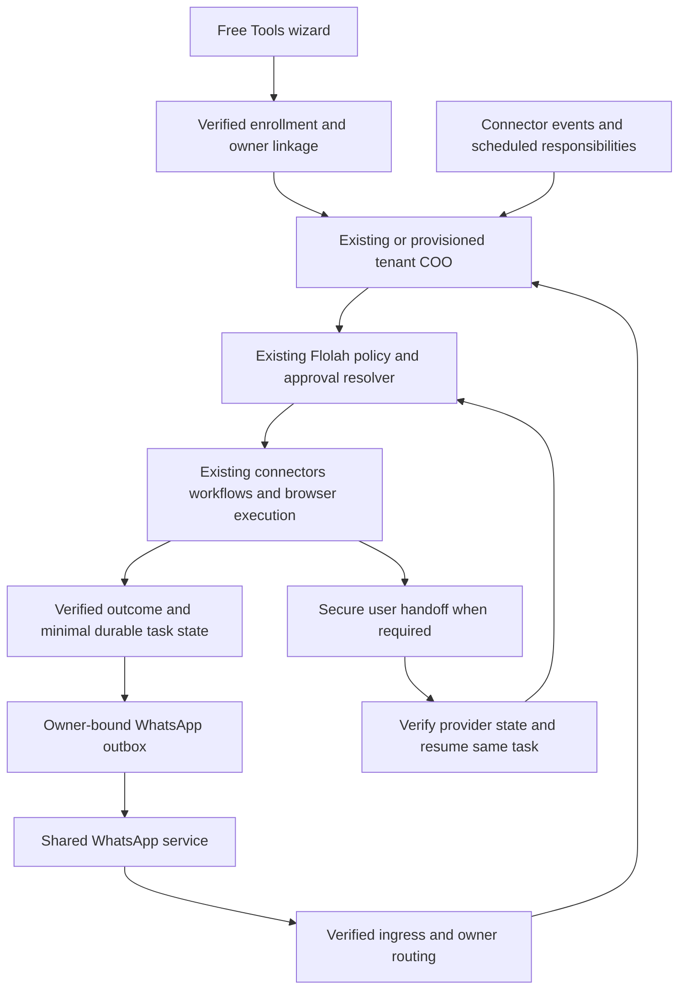

# FloAssist Analysis Design and Single Phase Implementation Plan

Status: implementation proposal based on the agreed product scope and source review on 24 October 2026. This document specifies work to implement; it does not claim that FloAssist is deployed or that live providers have been validated.

FloAssist is a free WhatsApp personal assistant for consumers and professionals in Singapore, India, and Indonesia. It configures the user's Flolah COO, using Flolah accounts, connectors, skills, policies, approvals, workflows, schedules, and task execution. New users enter through Free Tools and complete a lightweight onboarding wizard. Full Flolah login and management remain optional. Existing users receive an additive uplift to their existing COO.

## 1 Agreed scope and product contract

- One FloAssist service number, with each verified user routed to their own Flolah owner and COO runtime.
- New account provisioning and connector ownership happen behind onboarding. No password, company setup, API key, agent hiring, or dashboard visit is required for ordinary use.
- Existing account ownership must be verified before linking. Reuse its owner ID, COO, connections, and policy configuration. Do not create a second personal workspace.
- Gmail, Google Calendar, Outlook Mail, Microsoft Calendar, Google Drive, and OneDrive are selectable during onboarding. Multiple connections require an explicit default for each capability.
- Conversational tasks, one-off and recurring reminders, email and file assistance, browser work, bookings, and purchases are all in this release.
- Morning briefings, priority alerts, conflict monitoring, deadline tracking, and follow-ups are all included. Users can individually pause and configure them.
- Advisory is the default experience for new users. Managerial and Administrative are configuration presets over Flolah policy; the effective action policy is authoritative.
- External actions default to approval required. Financial/destructive actions retain the platform's prohibited default until configured otherwise. If the effective financial/destructive policy is Autonomous, FloAssist may complete supported transactions autonomously. There is no unconditional payment-handoff rule.
- When policy or provider interaction requires the user, send a WhatsApp link and preserve task continuity. Provider login, OTP, CAPTCHA, or payment authentication can require handoff even with autonomous permission.
- Source content is transient by default; minimal task state persists. Long-term personal memory is opt-in.
- Service access is free with fair-use limits. Merchant purchases remain payable by the user; free service does not mean free goods or bookings.

One implementation phase means one integrated release containing this full scope. The work packages below are execution order and dependencies, not separate product phases or deferred features.

## 2 Existing implementation analysis

### Account and COO reuse

[users.js](../backend/src/services/users.js) implements `registerCeoUser`, personal industry defaults, standard agent grants, tenant initialization, model settings, and legal acceptance. It currently requires email, password, and name. [auth.js](../backend/src/routes/auth.js) invokes account registration and tenant provisioning. [ceo-openclaw-provision.js](../backend/src/services/ceo-openclaw-provision.js) provisions granted tenant runtimes, tool credentials, allowlists, and organization context. [openclaw-tenant.js](../backend/src/services/openclaw-tenant.js) synchronizes assigned skills.

Reuse these primitives through a verified passwordless registration path. Extract common account initialization rather than supplying a shared or invented user password. Resolve the user's entitled COO from platform data and runtime identity; do not assume a static agent ID or display name. Registration currently tolerates some provisioning failures, so FloAssist activation needs an explicit readiness checklist and retryable provisioning state.

### Free Tools entry

The public catalog is [free-tools/index.html](../deploy/static/flolah-home/free-tools/index.html), with a second tool surface in the [public home page](../deploy/static/flolah-home/index.html). Digital Adoption demonstrates a Free Tools experience with a separate email-code session and optional Flolah management; see [its user guide](../docs-site/docs/systems/digital-adoption.md). Reuse the interaction pattern, while binding FloAssist identity to an actual Flolah owner. Do not couple FloAssist authentication to Digital Adoption's service database.

### Existing policy is the authority

[action-policy.js](../backend/src/services/action-policy.js) already implements read, internal write, external communication, and financial/destructive families; autonomous, approval-required, and prohibited modes; and owner-scoped overrides. The documented override order is goal, workflow, agent, tool, then company fallback. Preserve that resolver rather than introducing a competing policy engine. [chat-action-approval.js](../backend/src/services/chat-action-approval.js) binds decisions to owner, action, arguments, expiry, and execution state. [policy documentation](platform-help/10-policies-guardrails.md) describes bounded recurring grants.

Browser operations already identify purchase, payment, order submission, and deletion as financial/destructive effects. The inspected amount constraint compares a numeric amount; a cross-currency purchasing contract must additionally bind currency and final total. Extend the existing constraint machinery where needed, keeping approval and execution in the same policy path.

### Connectors and proactive events

[event-productivity.js](../backend/src/services/event-productivity.js) provides capability bindings and normalized email, calendar, and file events. [event-productivity-listeners.js](../backend/src/services/event-productivity-listeners.js) provides provider listener infrastructure. [the implementation reference](EVENT-PRODUCTIVITY-PACK-V1.md) documents deduplication, retries, owner-scoped targets, minimal receipts, and exact provider action bindings. Use this for the five proactive responsibilities.

[connector-action-grants.js](../backend/src/services/connector-action-grants.js) contains agent-keyed grants in the shared schema and legacy broad-access behavior when no grants exist. FloAssist must not use a shared COO catalog ID to change every user's permissions or accidentally change an existing user's broad grants to a reduced allowlist. Add owner-scoped connector grants with explicit compatibility handling, and prove owner isolation. [agent-skills.js](../backend/src/services/agent-skills.js) already has owner-and-agent-scoped skill assignments; use its versioning and assignment path.

### WhatsApp and browser continuity

[ceo-agent-channels.js](../backend/src/services/ceo-agent-channels.js) implements tenant channel setup using WhatsApp session pairing. [channel-user-identity.js](../backend/src/services/channel-user-identity.js) resolves actors within a known owner. Neither alone establishes the new shared-number lookup from a verified sender to the correct owner. Add that ingress routing adapter; then use existing owner/actor checks. [agent-channel-announce.js](../backend/src/services/agent-channel-announce.js) is the existing outbound delivery integration point.

[browser-tasks.js](../backend/src/services/browser-tasks.js) preserves task steps and resumes blocked tasks. That is a useful foundation, but it is not evidence of transferable merchant checkout sessions or a mobile remote-browser handoff. Build and test those continuations explicitly. Existing [connector execution policy](../backend/src/services/connector-execution-policy.js) avoids retrying writes after ambiguous failures; preserve this behavior for purchases.

### Privacy and persistence

[data-retention.js](../backend/src/services/data-retention.js) currently uses 30, 60, 90, 120, or 365 days, with 90 days as default. [channel documentation](platform-help/24-agent-channels.md) describes durable attachment mirroring into Content Explorer. These mechanisms do not constitute transient processing. FloAssist must carry its processing profile through connector results, agent prompts, browser traces, attachments, workflow outputs, and telemetry. Existing users' unrelated COO history and company knowledge remain under their established settings.

## 3 User journeys

### New user from Free Tools

1. Open the FloAssist card and choose Get started. Enter email and phone; show service terms, data handling, and proactive WhatsApp opt-in. Infer country and timezone only as suggestions; confirm the timezone because Indonesia spans multiple zones.
2. Verify email with a short-lived code or link. Verify the WhatsApp identity using a one-time onboarding challenge sent from the declared phone to the service number, or the chosen provider's verified equivalent. Never bind an account merely from typed contact details.
3. Establish a restricted onboarding session. Provision the personal Flolah owner and resolve/provision its COO in the background after verified consent. Repeated callbacks and refreshes resume the same enrollment.
4. Select connectors and complete OAuth. Explain requested actions and allow skipping/retrying individual connections. Provider credentials remain in the existing connector runtime. Bind the exact connected account and capabilities to the user.
5. Review autonomy. Start in Advisory with no autonomous changes to connected systems. Show existing Flolah settings for approval-required actions and financial/destructive restrictions. Choose presets or individual settings; preview effects before saving through existing policy services.
6. Enable all five responsibility templates, subject to user selection and available capabilities. Configure briefing time, quiet hours, priority contacts, preferred calendar, and optional monitored folders/labels. Use sensible editable defaults so onboarding stays short.
7. Confirm transient processing and optional memory. Activate only after identity, COO runtime, messaging route, and minimum selected capability readiness succeed. With no connectors, activate reminders and general assistance and show which responsibilities await a connection.
8. Send a welcome message and a first-task suggestion. The web completion page can close. Flolah account management is an optional link, not a mandatory redirect or company-setup gate.

### Existing Flolah user

After verification, link to the existing owner and entitled COO. Existing MFA requirements still apply to account linking; this can be a brief embedded verification without a dashboard visit. Preserve existing connectors, grants, model preference, persona, skills, policies, workflows, schedules, and channel bindings. Display the current effective settings, including a Custom label when they differ from a preset. Offer only explicit changes; do not silently reset an autonomous account to Advisory.

Apply the assistant skill pack additively, with assignment provenance and version. Reuse compatible connections and subscriptions, with a reference to their original ownership. Avoid duplicate briefings or alerts when an equivalent responsibility already exists. Handle no-COO and multiple-COO cases through entitlement/readiness resolution rather than picking a name. Organization delegates must not silently acquire ownership of a CEO account; use existing roles and require an entitled owner for enrollment.

### Ordinary WhatsApp use

Support natural requests and clear control intents: remind, reschedule, snooze, list reminders, pause all, resume, connect an app, change preferences, review permissions, forget a remembered fact, and stop the service. Bind approvals to task IDs/buttons when multiple requests are pending. If a text reply such as Yes is ambiguous, ask which task. Status questions never restart purchases or other work.

Connecting an app, updating identity, reviewing broad permissions, or taking over a browser may open a secure lightweight page. Ordinary tasks and replies remain in WhatsApp. A request to open full Flolah management exchanges a verified session through the existing authentication boundary; do not put broad login tokens into chat URLs or bypass account MFA.

## 4 Architecture and execution contracts

The FloAssist layer owns enrollment, channel routing, product preferences, entitlement/budget checks, handoff state, and data-processing context. Flolah continues to own agents, skills, source credentials, execution, policies, approvals, schedules, and durable work outcomes.

Every incoming message and background job carries a trusted owner ID, actor identity, resolved COO runtime ID, source message/event ID, conversation/work ID, processing-profile version, and applicable policy scope. Derive these from authenticated records, never from a model-supplied owner ID. Revalidate connection ownership and current policy before each side effect and after every human handoff.

### Shared WhatsApp transport

Implement an adapter with verified inbound-message handling, send-message, send-template where applicable, media retrieval, and delivery-status callbacks. Verify provider signatures before sender resolution. Persist provider message IDs for deduplication; acknowledge accepted delivery promptly and execute through bounded per-owner queues. Serialize conflicting actions on the same work item while allowing unrelated reads.

Keep the service account credentials platform-owned. Bind the verified sender to exactly one active enrollment for this service route. Unknown senders get enrollment help without account disclosure. Phone changes require verification of the new binding and revocation of old sessions; ambiguous ownership or reassigned numbers trigger re-verification. Never route replies through a global last-active COO.

Use an outbox with owner, work ID, recipient binding version, message type, retry status, and dedupe key. Recheck recipient and enrollment state before delivery. Distinguish accepted, sent, delivered, and failed states. Business Platform rules, if that is the approved transport, require templates outside its customer-service window. Keep user opt-out, template failure, and channel outage behavior explicit.

### Policy semantics and payment behavior

Preset names describe configuration; they do not create independent authority. Advisory means reading and proposing by default. A source-system mutation is possible only through the configured approval-required path with a valid approval, or an explicit change to an autonomous setting. A prohibited action remains blocked. Internal reminder state and consented messages to the owner need narrowly scoped permissions so Advisory can function without permitting email to other recipients.

Managerial exposes creation, updates, and external communication settings; Administrative additionally exposes deletion settings. Selecting either does not silently enable financial activity. Show the resolved financial/destructive mode separately. Preserve the existing goal/workflow/agent/tool/company precedence, including intentional scoped exceptions. Existing user overrides remain effective unless the user changes them.

Before a booking or purchase commitment, resolve the actual operation, merchant, final amount, currency, cancellation terms, recipient/traveler identity, and idempotency reference. A zero-cost reservation is still an external commitment. Do not classify a checkout or order button as navigation merely because it is reached through the browser.

- **Prohibited:** do not execute the commitment. The user may still receive research and a normal merchant link to act independently; opening it does not grant FloAssist permission.
- **Approval required:** present the exact commitment in WhatsApp. A valid approval authorizes only that operation. Use a payment or browser link when the user needs to authenticate or complete the transaction.
- **Autonomous:** execute when the tool/provider supports it and all effective constraints are satisfied. Do not add an obligatory human-payment step. Authentication challenges or unavailable provider capabilities still lead to handoff.

Extend the canonical constraint contract with amount in minor units, currency, merchant identity/domain, and total including taxes/fees as needed. Financial approval and autonomous budget checks must use the final quote. Do not infer conversion between SGD, INR, and IDR or reuse a numerical cap across currencies. If a refreshed quote violates a bound, obtain a new authorization or stop according to policy.

### Durable handoff and continuation

Represent the interaction as a linked work item with states `researching`, `prepared`, `awaiting_approval`, `awaiting_user`, `executing`, `verifying`, `completed`, `failed`, `cancelled`, and `expired`. Store this as an extension/reference to the existing goal/browser work, not a second competing execution engine. Track transition version, executor lease, and verification outcome to prevent two resumptions from committing twice.

Prefer a provider-generated checkout or reservation URL. If unsupported, issue an authenticated FloAssist handoff to the isolated browser context. If a site supports neither, provide its legitimate link and retain selected-option details; clearly state when the prepared cart cannot transfer. Do not promise universal browser automation or successful checkout on every merchant.

A handoff token is hashed at rest, short-lived, owner/task/purpose-bound, and exchanged for a scoped session. Opening the URL does not approve or resume work. Link previews and scanners must be harmless. Require authenticated confirmation for a sensitive continuation; use no-referrer pages and redact tokens from access logs. For browser takeover, suspend agent input and transfer an exclusive lease; restore agent control only after the user finishes or the lease expires. Do not expose other tabs, files, owners, or browser profiles.

After user completion, verify using an authenticated provider callback, provider lookup, confirmation page, or an authorized receipt lookup. A message saying Paid starts verification; it is not proof. On uncertain write outcome, reconcile before retrying. Notify once when verified, then schedule or update related tasks under their own policies. Expired quotes, abandoned checkout, cancellation, and revoked access are terminal or re-planning transitions, never blind resubmissions.

### Proactive responsibilities and reminders

Implement all five as versioned templates using existing scheduled goals and event subscriptions:

1. **Morning briefing:** one local-time schedule aggregates agenda, selected priorities, outstanding deadlines, and follow-ups. Display unavailable sources honestly.
2. **Priority alerts:** email events plus configured people/topics feed a significance check, with deduplication and a daily interruption allowance.
3. **Conflicts:** calendar changes trigger overlap and availability checks across selected calendars. Suggest resolution in Advisory; reschedule only under effective policy.
4. **Deadlines:** authorized email/document reads produce a minimal candidate with source reference, due time, confidence, and user correction path. Ask on consequential ambiguity before creating a reminder or commitment.
5. **Follow-ups:** track user-selected threads or explicitly enabled rules, detect replies, close resolved items, and remind or send follow-ups according to policy.

Use provider event support when available and existing listeners/reconciliation otherwise. Establish a baseline so onboarding does not flood users with historical alerts. Bound scans and apply backoff. Persist event/object versions and task correlations; renewing subscriptions or replaying events must not duplicate reminders, bookings, or messages. Source content is untrusted data, not instructions to change policies or disclose another connector's data.

Reminders need durable one-off and recurring due times, timezone, snooze/cancel, restart recovery, and deduplicated delivery. Confirm whether existing scheduled-goal support covers each operation; add missing one-off behavior to the shared scheduling infrastructure. Handle ambiguous natural-language times with clarification, and use IANA timezones including Asia/Singapore, Asia/Kolkata, and the user's selected Indonesian zone. Quiet hours defer routine alerts; explicit reminder timing and configured urgent exceptions determine interruptions.

### Privacy and memory

Introduce a processing context on every FloAssist task, including existing-user tasks entered through this channel. Reuse the same COO with a bounded conversation context: do not automatically ingest the existing company archive into a new personal request. Explicitly authorized source retrieval can still use existing user data.

Proposed defaults, configurable in the product profile:

- Raw connector text, attachments, screenshots, and browser traces: memory-only where possible; encrypted temporary material where needed, removed on task completion with a maximum 24-hour TTL. Do not include it in backups or indexes.
- Handoff continuity: persist references, selected options, and the minimum user-visible transaction summary. Refetch source content after restart instead of keeping full pages or mailboxes.
- Chat continuity: a rolling 24-hour raw-context window for FloAssist conversations, followed by deletion; keep only explicitly saved memory and minimal active-task facts. Show this behavior during onboarding.
- Active reminders, commitments, and follow-ups: retain necessary facts until closed or cancelled. Retain minimal terminal task/receipt metadata for 30 days by default, subject to the user's applicable retention and required records. These facts are data, even when summarized.
- Credentials: remain in the existing encrypted connector/vault path until disconnected or revoked. They are not transient task content.
- Personal memory: off by default, explicit save/edit/delete and provenance; no automatic embedding or company-memory capture from FloAssist conversations.

The TTL values are design defaults, not claims about existing behavior. Implement filtering before durable writes, not only a purge job. Audit OpenClaw transcripts, Brain/workflow outputs, approval `args_json`, Content Explorer mirrors, browser profiles/downloads, errors, telemetry, caches, model-provider retention, indexes, and backups. Approval records should reference encrypted expiring arguments where raw content is necessary, preserving exact-action hashing without indefinite plaintext copies. Metadata and summaries must be minimized and treated as personal data.

Explain separate actions: pause assistant, disconnect a connector, forget memory, delete FloAssist data, and delete the Flolah account. Disabling FloAssist for an existing user removes only FloAssist-owned responsibilities/assignments and leaves shared assets intact. Revoke relevant pending work before deleting its data so it cannot be recreated by an old job. Data already delivered to WhatsApp or a merchant follows those services' retention; do not promise erasure of external copies.

### Free usage and regional behavior

Store per-owner and platform-wide quotas for model spend, browser runtime, background checks, and outbound messages in configurable product/admin data. Use the existing model routing system and platform-funded entitlement for the free path; new users must not supply a key. Existing users retain their selected model settings, with the funding source made explicit if their BYOK is used. Do not silently switch existing paid configurations.

Reserve budget before work, reconcile after completion, and prevent concurrent jobs from overspending. Degrade expensive scans into digest mode or pause them with a clear notice. Preserve stop, cancel, connection recovery, and safety-critical transaction-status reconciliation when ordinary quotas are exhausted. A limit must not leave a possibly completed payment to be retried later without verification. Select numerical caps from measured canary costs before release; do not market unlimited service.

Treat country, timezone, language, and currency as separate preferences. Initial UI copy can be English with a localization-ready structure; support user-selected conversational language subject to model testing, without promising unvalidated language coverage. Use explicit dates, international phone normalization, local-time summaries, and currency-labelled prices. Record country-specific provider availability and delivery results for all three launch markets.

## 5 Data and API design

Names below are proposed; existing equivalent tables/services should be extended rather than duplicated. Use the repository's established database boundary deliberately: global enrollment routing requires a platform registry; work payloads follow the owner's current shared/tenant storage configuration.

- `floassist_enrollments`: unique owner/product enrollment, verified identity binding reference, resolved COO, onboarding/readiness state, product version, consent versions, privacy-profile version, preferences, lifecycle timestamps.
- `floassist_identity_bindings`: service route, provider sender ID, encrypted contact value where needed, lookup fingerprint, owner, verification/version/revocation timestamps; uniqueness for active sender bindings. Do not expose sequential account identifiers publicly.
- `floassist_onboarding_sessions`: hashed credentials/challenges, purpose, expiry, verification attempts, verified owner linkage, resumable step state. Authentication challenges never store plaintext codes.
- `floassist_resource_links`: enrollment, existing skill assignment/subscription/schedule/connection/work ID, created-versus-reused provenance, version. This enables additive uplift and safe opt-out.
- `floassist_handoffs`: owner/work/browser references, state/version, quote fingerprint, expiry, hashed token, verification status, and minimal provider references. Do not store card numbers, CVV, or OTPs.
- `floassist_message_outbox`: owner, enrollment/binding version, source work/event, provider message ID, delivery lifecycle, dedupe key, retry/expiry metadata. Payload bodies follow the transient policy.
- `floassist_usage`: reservations and settled usage by dimension, owner, and billing window, linked to existing accounting where available.

Keep existing policy, approvals, event inbox, scheduled goals, skills, and connector credentials canonical. Product tags and capability mappings are data-driven. No hardcoded COO names, provider action IDs, merchant domains, production origins, model names, or numerical quota settings in core logic.

Proposed routes:

- `POST /api/floassist/onboarding/start`, `/verify-email`, `/verify-phone`, `/complete`; `GET /api/floassist/onboarding/status`.
- `GET /api/floassist/connections`; `POST /api/floassist/connections/:provider/authorize`; provider callback routes using existing connector OAuth services and state/nonce binding.
- `GET/PATCH /api/floassist/preferences`; `GET /api/floassist/policy-preview`; policy writes delegate to existing policy APIs with authenticated owner context and MFA where required.
- `GET/POST /api/floassist/webhooks/whatsapp` for provider verification/inbound delivery, plus delivery status handling appropriate to the selected provider.
- `GET /api/floassist/handoffs/:id` for scoped review; `POST .../exchange`, `.../complete`, and `.../cancel` for authenticated state changes. GET requests are side-effect free.
- `POST /api/floassist/pause`, `/resume`, `/disconnect`, `/forget`, and `/account-access` with purpose-specific authorization.

Use standard error classes for verification needed, connection expired, policy prohibited, approval needed, quote expired, uncertain provider outcome, quota reached, and channel unavailable. Do not expose account existence on public enrollment endpoints. Server-derived ownership is mandatory on every resource read or write.

## 6 Single phase execution plan

### Work package 1 Establish provider and integration contracts

Owner role: platform integration lead. Dependencies: none.

Confirm the permitted shared-number WhatsApp transport for this product and all three countries, provider callbacks, proactive-message rules, pricing, and media behavior. Document the actual provider adapter contract and test credentials. Inventory exact connector capabilities against the deployed catalog and validate supported checkout/handoff mechanisms with representative merchants. Record the funding/model route, privacy processor settings, and proposed quotas.

Deliverable: configuration manifest and executable provider fixtures. Exit: transport and catalog assumptions are evidence-backed, or named external blockers are recorded; no unsupported country capability is represented as ready. Other implementation work can proceed against fixtures, but launch cannot bypass this dependency.

### Work package 2 Implement enrollment and existing COO uplift

Owner role: backend identity engineer. Dependencies: integration identity contract.

Add versioned enrollment schema, restricted sessions, email/phone verification, and idempotent background provisioning. Extract reusable registration initialization from `users.js`; add a passwordless credential path and later optional account-access enrollment without weakening existing MFA. Resolve and reuse the entitled COO. Record readiness and compensating cleanup for partial failures. Add provenance for product-owned assignments and resources.

Primary changes: `backend/src/services/users.js`, `routes/auth.js`, `services/ceo-openclaw-provision.js`, new `services/floassist-enrollment.js`, `services/floassist-identity.js`, and `routes/floassist.js`.

Exit: a new user and an existing user both enroll without duplicate owners or COOs; retries and concurrent callbacks converge; existing settings remain intact; no dashboard visit is required.

### Work package 3 Deliver Free Tools onboarding and optional management

Owner role: frontend engineer. Dependencies: enrollment and connector contracts.

Add the FloAssist card and public landing/wizard at `/free-tools/floassist/`. Implement identity verification, connector checkboxes and OAuth continuation, policy previews, responsibility preferences, privacy choice, and completion. Use a restricted product session and same-origin API routing. Provide secure lightweight settings and optional full-Flolah management access. Account for mobile browsers, OAuth popup/redirect failures, back navigation, expired sessions, and accessibility.

Primary changes: `deploy/static/flolah-home/free-tools/index.html`, `deploy/static/flolah-home/index.html`, new `deploy/static/flolah-home/free-tools/floassist/`, API/deployment route configuration, and relevant connector/policy UI integration.

Exit: the complete mobile journey works from Free Tools to the first WhatsApp task, including partial connection failure and resumed onboarding.

### Work package 4 Connect shared WhatsApp to tenant COO execution

Owner role: messaging backend engineer. Dependencies: verified enrollment and provider transport.

Build signed webhook ingress, sender-to-owner lookup, conversation binding, dedupe, queueing, approvals, delivery outbox, opt-out, and status reconciliation. Integrate existing actor authorization, chat approval, COO runtime execution, and outbound announce paths. Preserve existing tenant-paired WhatsApp channels. Add bounded media handling through the privacy profile.

Primary changes: new `services/floassist-whatsapp.js`, `services/floassist-outbox.js`, `routes/floassist-webhooks.js`; integrate `channel-user-identity.js`, `chat-action-approval.js`, and `agent-channel-announce.js`.

Exit: two users interleave messages and approvals without cross-routing; duplicate callbacks execute once; outages/restarts recover; messages after opt-out are suppressed.

### Work package 5 Bind connectors skills and all proactive responsibilities

Owner role: platform automation engineer. Dependencies: enrollment, owner scoping, messaging.

Add owner-scoped connector grant compatibility and automated capability binding from validated live catalog metadata. Create a versioned assistant skill pack with tags such as personal assistance, email, calendar, files, reminders, browser, bookings, and purchase continuity. Assign to the resolved COO using existing skill APIs; merge rather than replace existing assignments. Configure all five responsibility templates through existing event and scheduled-goal services. Add missing one-off reminder behavior to shared scheduling if needed.

Primary changes: `connector-action-grants.js`, `agent-skills.js`, `platform-skill-catalog.js`, `event-productivity.js`, `event-productivity-listeners.js`, `scheduled-goals.js`, and proposed `services/floassist-responsibilities.js` plus versioned skill/template data.

Exit: each responsibility demonstrates an event-to-outcome path on Google and Microsoft fixtures; baseline and replay do not duplicate work; live capability probes confirm the selected provider actions.

### Work package 6 Implement booking purchase and browser continuation

Owner role: browser and transaction engineer. Dependencies: policy context, messaging, owner-scoped browser execution.

Add task-linked handoff records, mobile review/continuation pages, provider links, exclusive browser takeover, final-quote normalization, currency-aware constraints, and verified resumption. Reuse existing browser pause/resume and approvals. Ensure autonomous financial policy completes supported actions without an extra payment gate; preserve required provider authentication. Handle no-cost bookings, approval expiry, quote changes, uncertain outcomes, cancellations, and refunds with effect-appropriate policies.

Primary changes: `browser-tasks.js`, `routes/browser-session.js`, `action-policy.js`, `chat-action-approval.js`, proposed `services/floassist-handoffs.js`, and public handoff UI.

Exit: prohibited, approval-required, and autonomous transaction cases all behave correctly; mobile handoff continues the same task; duplicate clicks and delayed callbacks cannot create a second commitment.

### Work package 7 Enforce transient processing and free-service budgets

Owner role: platform data/runtime engineer. Dependencies: all execution contracts; implemented across earlier packages, completed here.

Thread the processing context through COO prompts, workflows, connector results, browser traces, media, approvals, and logs. Add encrypted temporary payload references, deletion sweeps, memory opt-in controls, and FloAssist-specific conversation boundaries. Implement quota reservation, settlement, digest degradation, platform-funded model routing, and continuity exemptions. Add operational metrics without raw content.

Primary changes: `data-retention.js`, relevant content/media and workflow persistence services, existing model/budget routing, proposed `services/floassist-processing-profile.js` and `services/floassist-usage.js`.

Exit: seeded sensitive content disappears from controlled stores within the promised window; existing non-FloAssist history remains intact; budget races cannot overspend; pending transaction verification survives quota exhaustion.

### Work package 8 Validate and release the complete scope

Owner role: release engineer with feature owners. Dependencies: all prior packages complete.

Run deterministic contract suites, browser/mobile end-to-end checks, provider sandboxes, and authorized live canaries across all three countries. Publish user help, troubleshooting, data-handling disclosures, provider capability limitations, and operational runbooks. Release behind a server-controlled enrollment flag, then open the Free Tools card when all gates pass. A controlled rollout is validation of the same complete release, not a smaller feature phase.

Exit: every acceptance scenario below passes or the release remains explicitly blocked by a named external prerequisite. No release claim based only on mocked integrations.

### Dependency order and sizing

Critical path: provider contract and identity → enrollment and owner-scoped routing → connector/policy integration → payment continuity → integrated validation. UI, responsibility templates, and privacy hooks can be developed alongside the relevant backend contracts; this describes work organization, not authorization to spawn agents or separate chats.

Planning estimate: 40–60 engineering days plus 8–12 QA/release days, assuming existing services are reusable as inspected and provider access is available. With three engineers and QA overlap, allow approximately 5–7 calendar weeks. This is an estimate, not a commitment; merchant/browser compatibility and provider eligibility can extend elapsed time. All agreed capabilities remain within the one release.

## 7 Acceptance and verification

1. **New signup:** email plus phone verification creates one owner, links one COO, connects selected services, and reaches WhatsApp without full Flolah login. Partial provisioning resumes after a restart.
2. **Existing uplift:** the same owner and COO IDs remain; existing policies, persona, connector access, skills, schedules, and history survive. Repeated enrollment adds no duplicate resources.
3. **Isolation:** two owners share the service number but cannot see each other's messages, approvals, connections, files, browser sessions, or handoffs. Test both shared-DB and tenant-DB account modes.
4. **Policies:** source-system reads work in Advisory; mutations require the configured path. Prohibited actions reject grants; approval-required actions execute only the exact approved arguments; autonomous actions execute within configured bounds. Test scope precedence and policy changes while work is pending.
5. **Payments:** test SGD, INR, and IDR; final fees; expired/changed quotes; permitted and disallowed merchants; autonomous execution; provider authentication; failed verification; duplicate callbacks; and ambiguous network timeouts. No duplicate commitment.
6. **Bookings:** paid and zero-cost reservations, attendee identity, cancellation terms, abandoned handoff, and confirmation-to-calendar continuation each follow the correct policy.
7. **Browser:** mobile takeover preserves the right session, stops agent input, and safely returns control. Link preview, expired token, wrong user, missing worker, and browser restart cases are covered.
8. **Connectors:** Gmail/Google Calendar/Drive and Outlook/Microsoft Calendar/OneDrive work through exact owner bindings. Cover expired OAuth, missing scope, multiple accounts, disconnect, and action catalog changes.
9. **Proactivity:** all five responsibilities produce useful outcomes; baseline scans avoid alert floods; event replay and schedule restart produce no duplicates; quiet hours and timezone boundaries behave correctly.
10. **Reminders:** one-off, recurring, snooze, cancellation, missed-delivery recovery, and ambiguous-time clarification work through WhatsApp.
11. **Privacy:** seed distinctive content and inspect transcript, workflow, approval, event, browser, media, log, cache, index, and backup paths. Confirm TTL deletion and memory opt-in; verify existing company data is unaffected.
12. **Free usage:** concurrent reservations respect limits; expensive work pauses clearly; control commands and uncertain-transaction reconciliation remain available; no unexpected user charges.
13. **Lifecycle:** pause, resume, opt-out, phone change, reconnect, selective forgetting, FloAssist deletion, and optional account access are tested. Product removal does not delete shared Flolah resources.
14. **Regional delivery:** record actual delivery/continuation outcomes for Singapore, India, and Indonesia with the selected provider, including proactive messaging and local-time scheduling.

Run the existing relevant backend suites: `test:action-policy`, `test:notify-approval`, `test:security:tenant-tools`, `test:event-productivity-pack`, `test:event-productivity-agentic-binding`, `test:event-productivity-listeners`, `test:agent-skills`, `test:browser-executors`, `test:browser-task-routing`, and `test:browser-maturity`, plus frontend build. Add focused FloAssist suites for enrollment, routing, existing-user uplift, handoffs, privacy, and budgets. Run against isolated fixture databases. Real purchases require a separately authorized live test or provider sandbox; a harness is not live-payment evidence.

## 8 Release dependencies and operations

### WhatsApp eligibility

As checked on 24 October 2026, the [WhatsApp Business Messaging Policy](https://whatsappbusiness.com/policy/) describes opt-in and template requirements, while [Third Party Agent Terms](https://www.whatsapp.com/legal/third-party-agents-terms) apply to agents connected through a distinct 3P platform. Neither establishes our developer access or country eligibility. The current [Business Solution Terms entry](https://www.whatsapp.com/legal/business-solution-terms) redirected to a login page during review, so its latest complete provider conditions could not be verified here. Obtain provider confirmation for this product and all three markets. Do not treat pairing support or public end-user agent terms as production approval.

The chosen transport determines encryption and processing disclosures; do not reuse a generic claim that all assistant conversations are end-to-end encrypted. Preserve the shared-service-number product decision unless the provider cannot support it; such a result requires a product decision, not a silent switch to personal account pairing.

### Other release gates

- Provider OAuth applications configured and approved for the actual requested scopes; personal Google/Microsoft account flows validated, not only enterprise accounts.
- Browser isolation and mobile continuity demonstrated on representative supported sites; provider-specific unsupported cases handled honestly.
- Funding and model processor configuration support the published free usage and privacy promise.
- Final country-specific terms, notices, account eligibility, and data handling reviewed for the actual hosting/processor arrangement. No assertion of legal compliance follows from this technical design.
- Configurable quotas, product origin, service-number identity, provider keys, template IDs, country availability, and feature flags managed through established platform configuration.

Monitor enrollment completion/failure, connection readiness, per-owner queue delay, reminder lateness, event replay, approval expiry, handoff abandonment, verified transaction outcome, duplicate suppression, delivery failure, cost by workload, and deletion-sweep health. Metrics exclude source content and credentials. Configure alerts for cross-owner routing failures, stuck uncertain transactions, deletion failure, and provider-wide delivery failure.

Rollback disables new enrollment and new FloAssist work through product flags, pauses only product-owned schedules/subscriptions, revokes handoff sessions, and drains/reconciles already-started commitments. Notify affected users where delivery permits. Preserve existing COO operation and necessary action receipts. Use additive database migrations and versioned templates so rollback does not require deleting accounts or restoring stale permissions.

## 9 Definition of done

FloAssist is complete when a new user can start from Free Tools, verify identity, connect their apps, and receive all agreed assistant capabilities on WhatsApp; an existing user receives the same capabilities on their existing COO; Flolah remains the policy and execution authority; payment handoff or autonomy follows effective policy; transient handling and free usage limits are verified; and the full scope operates through an eligible provider in Singapore, India, and Indonesia. Optional Flolah management is available whenever the user needs it, without being a prerequisite for everyday assistance.
